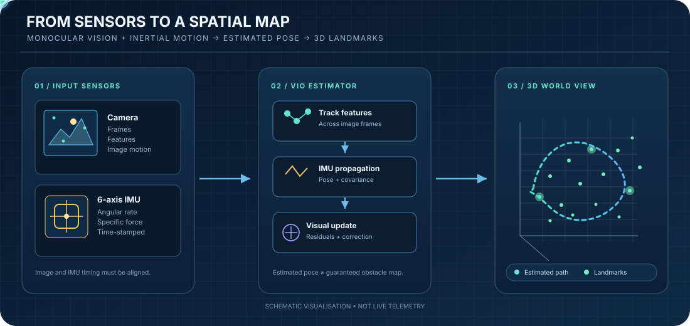
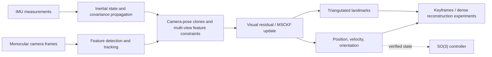
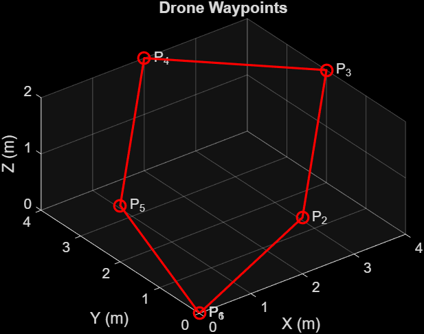
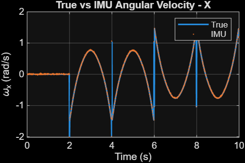
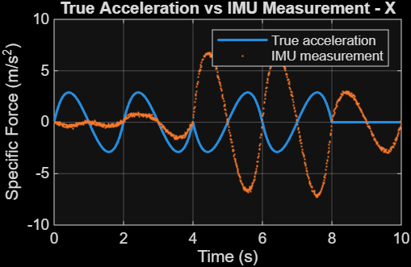
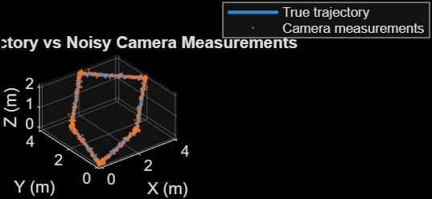

## 1. Amrita Logo

  

  <strong>Amrita Vishwa Vidyapeetham · Group CD2</strong> 
  Autonomous UAV Control, Visual–Inertial Odometry, and 3D Environment Mapping

---

## 2. Team Member Details (Name, Roll Number, Email)

| Name | Roll Number | Email |
|---|---|---|
| Ravishanmugam K | `CB.SC.U4AIE24347` | ravish2007801@gmail.com |
| Ishwarya Murugesan | `CB.SC.U4AIE24220` | ishwarya15m@gmail.com |
| Aparna Bharani | `CB.SC.U4AIE24304` | aparnabharani2006@gmail.com |
| Cibikumar B | `CB.SC.U4AIE24212` | cibikumar30@gmail.com |
| Akhilan S | `CB.SC.U4AIE24362` | akhilan1010@gmail.com |

> Team names, roll numbers, and email addresses above are retained from the existing project README.

---

## 3. Title

### 3D Mapping of an Environment Using a Normal Monocular Camera and Controlling the Drone by Visual–Inertial Odometry (VIO)

*A first-principles project exploring monocular visual–inertial state estimation, 3D reconstruction, and geometric multirotor control.*

  

  Project concept illustration. It is an explanatory animation, not a live sensor feed or an experimental result.

### Project at a glance

[-1D4ED8)](#6-methodology)

**Navigate:** [Abstract](#4-abstract) · [Introduction](#5-introduction) · [Methodology](#6-methodology) · [Results](#7-results) · [Conclusion](#8-conclusion) · [References](#9-references)

---

## 4. Abstract

This project investigates a drone workflow combining monocular-camera visual information, inertial measurements, 3D environment reconstruction, and geometric control. The repository has evolved across separate branches: the `main` branch contains a ROS 2 Python controller with an \(SO(3)\)-based attitude-control core, state adapters, trajectory generation, MATLAB experiment material, and simulation/project documentation. The separate `VIO-Controller` branch contains an experimental MSCKF-style visual–inertial estimator, synthetic trajectory evaluation, ROS 2 interface code, and a 3D reconstruction pipeline. A separate dashboard branch contains a browser-based visualisation prototype.

These components represent related parts of the intended system, but they should not be mistaken for a single, already validated flight stack. In particular, the existence of synthetic trajectories or a reconstruction module does not by itself establish accurate obstacle detection, real-time performance, or successful physical-drone flight. Results below are labelled by branch and evidence type so that the current implementation, experimental artifacts, and future integration work remain distinguishable.

---

## 5. Introduction

### Motivation

GPS-denied environments such as indoor spaces, corridors, and warehouses motivate onboard localization using sensors carried by the aircraft. A monocular camera supplies image features and visual motion cues; an IMU supplies angular-rate and specific-force measurements at a higher rate. Visual–inertial odometry (VIO) combines these complementary measurements to estimate motion. A 3D map or reconstructed surface is a related but separate output: pose estimation alone does not guarantee that obstacles have been segmented, classified, or made safe for navigation.

The controller work follows geometric methods that represent attitude with rotation matrices and errors on \(SO(3)\), while quaternion conversions are used at ROS message boundaries. This avoids using Euler angles as the controller's internal attitude representation; it does not remove the need to validate frame conventions, signs, timing, estimator accuracy, or the command interface.

### Repository branches reviewed

| Branch | Main contents observed | How to interpret it |
|---|---|---|
| [`main`](https://github.com/Ravish2807/Drones_S5_CD2_3D_Mapping_using_normal_monocular_camera_controlling_Visual-Inertial-Odometry-VIO/tree/main) | `drones_controller/`, MATLAB toy models, project documentation, and result images | Primary controller and project documentation branch |
| [`VIO-Controller`](https://github.com/Ravish2807/Drones_S5_CD2_3D_Mapping_using_normal_monocular_camera_controlling_Visual-Inertial-Odometry-VIO/tree/VIO-Controller) | `core/`, `datasets/`, `evaluation/`, `interfaces/`, `reconstruction/`, `results/`, and ROS 2 nodes | Separate experimental VIO and 3D reconstruction implementation |
| [`drones-controller`](https://github.com/Ravish2807/Drones_S5_CD2_3D_Mapping_using_normal_monocular_camera_controlling_Visual-Inertial-Odometry-VIO/tree/drones-controller) | A smaller ROS 2 controller package and launch/configuration files | Controller development branch |
| [`drones-dashboard`](https://github.com/Ravish2807/Drones_S5_CD2_3D_Mapping_using_normal_monocular_camera_controlling_Visual-Inertial-Odometry-VIO/tree/drones-dashboard) | Browser UI, bridge code, VIO-related plots/data, and architecture diagrams | Visualisation and integration prototype |
| [`gym-pyplot-drones`](https://github.com/Ravish2807/Drones_S5_CD2_3D_Mapping_using_normal_monocular_camera_controlling_Visual-Inertial-Odometry-VIO/tree/gym-pyplot-drones) | Simulation, trajectories, controller experiments, evaluation, and plotting | Separate control/simulation experiments |

Branch contents are not automatically integrated with one another. Paths and claims in this README therefore identify the branch that contains the corresponding artifact.

---

## 6. Methodology

### 6.1 System-level workflow

The target processing chain is camera and IMU input, visual tracking, inertial propagation, visual–inertial state correction, camera-pose output, and then reconstruction/visualisation. Controller execution is a related subsystem; it should consume a verified state estimate and validated commands rather than being treated as part of the estimator itself.

In the experimental VIO branch, a central frame relation is:

\[
T_{WC} = T_{WB}T_{BC}, \qquad
R_{WC}=R_{WB}R_{BC}, \qquad
p_{WC}=p_{WB}+R_{WB}p_{BC}.
\]

Here \(W\), \(B\), and \(C\) denote world, body, and camera frames. These equations depend on the repository's transform convention; every producer, residual, and evaluator must use that same convention.

### 6.2 Visual–inertial odometry (experimental branch)

The [`VIO-Controller/core/`](https://github.com/Ravish2807/Drones_S5_CD2_3D_Mapping_using_normal_monocular_camera_controlling_Visual-Inertial-Odometry-VIO/tree/VIO-Controller/core) directory contains the estimator-related implementation. Its module documentation describes feature tracking, IMU propagation, cloned camera poses, feature triangulation, and MSCKF-style residual projection.

A simplified error-state formulation is:

\[
\mathbf{x} =
\begin{bmatrix}
\mathbf{p}_{WB} & \mathbf{v}_{WB} & \delta\boldsymbol{\theta} &
\mathbf{b}_{a} & \mathbf{b}_{g}
\end{bmatrix}^{T},
\qquad
P^{-} = \Phi P\Phi^{T}+Q.
\]

For a tracked feature observed from multiple camera poses, the linearised residual can be written:

\[
\mathbf{r} \simeq H_x\delta\mathbf{x}+H_f\delta\mathbf{p}_f+\mathbf{n}.
\]

Projecting with a left-nullspace basis \(N\) such that \(N^{T}H_f=0\) removes the linearised feature-position error:

\[
\mathbf{r}_{o}=N^{T}\mathbf{r}, \qquad H_o=N^{T}H_x.
\]

An update then uses an innovation covariance and Kalman correction, subject to the implementation's gating and covariance conventions:

\[
S=H_oPH_o^{T}+R,\qquad
K=PH_o^{T}S^{-1},\qquad
\delta\mathbf{x}=K\mathbf{r}_o.
\]

These equations summarise the MSCKF approach; they are not a claim that every correction path has passed end-to-end validation. The estimator should be evaluated using controlled synthetic cases and then a public sensor dataset such as EuRoC before physical deployment.

### 6.3 SO(3) geometric controller (`main` branch)

The primary controller implementation is in [`drones_controller/drones_controller/so3_controller.py`](https://github.com/Ravish2807/Drones_S5_CD2_3D_Mapping_using_normal_monocular_camera_controlling_Visual-Inertial-Odometry-VIO/blob/main/drones_controller/drones_controller/so3_controller.py). Position and velocity tracking errors are:

\[
\mathbf{e}_{p}=\mathbf{p}_{d}-\mathbf{p},\qquad
\mathbf{e}_{v}=\mathbf{v}_{d}-\mathbf{v}.
\]

The implementation constructs an ENU-adapted desired force:

\[
\mathbf{F}_{d}
=m\left(K_{p}\mathbf{e}_{p}+K_{v}\mathbf{e}_{v}
+\mathbf{a}_{d}+g\mathbf{e}_{3}\right),
\qquad
\mathbf{b}_{3d}=\frac{\mathbf{F}_{d}}{\|\mathbf{F}_{d}\|}.
\]

A desired heading is used with \(\mathbf{b}_{3d}\) to construct the desired rotation matrix \(R_d\). The implemented geometric attitude error is:

\[
\mathbf{e}_{R}=\frac{1}{2}
\left(R_{d}^{T}R-R^{T}R_{d}\right)^{\vee},
\qquad
\mathbf{e}_{\Omega}=\boldsymbol{\Omega}
-R^{T}R_d\boldsymbol{\Omega}_{d}.
\]

The code calculates the desired moment using the configured gains, inertia matrix, gyroscopic term, and desired angular-rate feed-forward:

\[
\begin{aligned}
\mathbf{M}_{d}={}&-K_R\mathbf{e}_R-K_\Omega\mathbf{e}_{\Omega}
+\boldsymbol{\Omega}\times(J\boldsymbol{\Omega})\\
&-J\left(\widehat{\boldsymbol{\Omega}}R^{T}R_d
\boldsymbol{\Omega}_{d}-R^{T}R_d\dot{\boldsymbol{\Omega}}_{d}\right).
\end{aligned}
\]

The controller source explicitly notes that its force sign/frame adaptation must be validated experimentally. Also, the ROS node translates position/velocity intent into a bounded velocity command on `/ap/v1/cmd_vel`; it does **not** publish force or moment as though the velocity topic were an actuator interface. Command publishing is disabled by default in `drones_controller/config/controller.yaml` (`enable_command: false`). Confirm the flight-stack frame and topic semantics in simulation before enabling commands.

### 6.4 Mapping and 3D reconstruction (experimental branch)

The separate [`VIO-Controller/reconstruction/`](https://github.com/Ravish2807/Drones_S5_CD2_3D_Mapping_using_normal_monocular_camera_controlling_Visual-Inertial-Odometry-VIO/tree/VIO-Controller/reconstruction) directory documents an experimental pipeline that uses estimated camera poses to select keyframes, estimate depth, fuse points, and build a surface mesh. That is distinct from the controller currently on `main` and from the sparse feature landmarks used for VIO.

A point cloud is not automatically an obstacle map. For usable obstacle detection and navigation, future validation must address metric scale, reconstruction completeness, coordinate frames, depth uncertainty, moving objects, collision margins, and the latency from image capture to map update.

### 6.5 MATLAB experiment material

The `main` branch also contains MATLAB workflows in `toy_model/`, `toy_model2/`, and `toy_model3/`. These explore staged trajectory/control calculations and mathematical models, including an error-state EKF/SO(3) closed loop and separate DMDc/LQR/DARE/MPC exercises. They are study and simulation artifacts; their presence does not establish that each algorithm is part of the ROS 2 runtime controller.

### 6.6 State and control parameters

| Category | Parameters or current configuration |
|---|---|
| Estimated state | Position, linear velocity, attitude, accelerometer bias, gyroscope bias (experimental VIO branch) |
| Controller inputs | Position/velocity state, rotation matrix, angular velocity, desired position/velocity/acceleration, desired yaw |
| Controller gains | **kp**, **kv**, **kR**, and **kOmega** in the controller YAML configuration |
| Vehicle parameters | Mass, gravity, diagonal inertia matrix, maximum velocity, state timeout, control rate |
| Interface | ROS 2 pose and twist subscriptions; bounded velocity-command publishing, disabled by default |

### 6.7 Main-branch project layout

| Path | Purpose |
|---|---|
| [drones_controller/](drones_controller/) | ROS 2 Python geometric controller, state adapters, trajectory generator, and configuration |
| [toy_model/](toy_model/) | Staged MATLAB/live-script experiments |
| [toy_model2/](toy_model2/) and [toy_model3/](toy_model3/) | Executable mathematical models and MATLAB live scripts for estimation/control and DMDc/LQR/DARE/MPC exercises |
| [docs/](docs/) | Mathematical models and project documentation |
| [Results/](Results/) | Existing screenshots and project result captures |
| [Base Paper.pdf](Base%20Paper.pdf) | Project-provided base paper PDF |

---

## 7. Results

### 7.1 Existing project visuals on `main`

The following images are already committed under `Results/`. They are presented as project artifacts rather than as quantitative proof of estimator accuracy.

| Preview | Repository asset |
|---|---|
|  | [Results/image1.png](Results/image1.png) |
|  | [Results/image2.png](Results/image2.png) |
|  | [Results/image3.png](Results/image3.png) |
|  | [Results/image4.png](Results/image4.png) |

Additional existing captures include [Results/image5.png](Results/image5.png), [Results/image6.png](Results/image6.png), [Results/image22.jpeg](Results/image22.jpeg), and other [untitled PNG/JPEG captures](Results/). These are retained as artifacts, not as quantitative evidence on their own.

An earlier supplied clip is also linked here: [Previously supplied project clip](https://github.com/user-attachments/assets/0ed8133c-c115-4816-8c9a-0bfaf4fb959b). A team video folder is available at [Project video folder](https://drive.google.com/drive/folders/1iowpdHYk4qTKaGRoWc7l1Y_70IvifeuA?usp=sharing).

### 7.2 Synthetic VIO benchmarks in the separate `VIO-Controller` branch

The branch's evaluation documentation reports the following camera-trajectory metrics for its synthetic presets. The reported position error is camera ATE RMSE after the documented Umeyama \(SE(3)\) alignment.

| Synthetic preset | Camera ATE RMSE | Reported RPE drift | Orientation error RMSE |
|---|---:|---:|---:|
| Orbit | 0.3538 m | 0.1695 m/s | 1.92° |
| Multi-axis | 0.3834 m | 0.1954 m/s | 4.41° |
| Hover | 0.1341 m | 0.0186 m/s | 160.60° |
| Straight | 2.7091 m | 0.8255 m/s | 46.78° |
| Stress | 52.1553 m | 13.1805 m/s | 160.89° |

Source: [VIO-Controller evaluation README](https://github.com/Ravish2807/Drones_S5_CD2_3D_Mapping_using_normal_monocular_camera_controlling_Visual-Inertial-Odometry-VIO/blob/VIO-Controller/evaluation/README.md) and [camera metrics for the orbit preset](https://github.com/Ravish2807/Drones_S5_CD2_3D_Mapping_using_normal_monocular_camera_controlling_Visual-Inertial-Odometry-VIO/blob/VIO-Controller/results/metrics/synthetic_orbit_camera_metrics.json). These are **synthetic, branch-specific results**, not measurements from a physical drone. The poor orientation results for hover, straight, and stress, and the large stress-preset position drift, are material limitations—not results to hide or average away. The VIO branch needs further fusion/debugging and controlled repeatability checks; EuRoC evaluation and reference comparisons should follow once the synthetic estimator is trustworthy.

### 7.3 Demonstration video — placeholder for the final upload

> **[PLACEHOLDER — INSERT FINAL PROJECT DEMONSTRATION VIDEO HERE]**  
> Replace this block with the final YouTube link, GitHub video asset, or other stable demonstration URL when the team is ready. Do not treat the animated pipeline illustration above as the project demonstration.

### 7.4 Validation status

| Area | Evidence available in the repository | Status / limitation |
|---|---|---|
| SO(3) controller | ROS 2 Python package, controller configuration, diagnostics | Implementation exists; frame/sign and velocity-command behavior need simulation validation |
| VIO core | MSCKF-oriented code and synthetic artifacts on `VIO-Controller` | Experimental; synthetic benchmarks expose significant failure cases |
| 3D reconstruction | Keyframe/depth/fusion/meshing modules on `VIO-Controller` | Experimental pipeline; no verified obstacle-detection accuracy claim |
| ROS 2 integration | Controller package on `main`, VIO interface/node artifacts on separate branch | Integration status must be checked branch-by-branch |
| Physical-drone validation | No measured flight benchmark established by the README artifacts reviewed here | Not claimed |

---

## 8. Conclusion

The repository brings together several development tracks toward monocular-camera-based visual–inertial localization, 3D reconstruction, and drone control. The `main` branch is strongest as the home for the SO(3) controller, simulation-facing ROS 2 package, and MATLAB experiments. The separate VIO branch provides a substantial research implementation for MSCKF-style estimation and reconstruction, but its synthetic metrics show that it is not yet uniformly reliable. The dashboard and controller-development branches provide additional prototypes rather than proof of a single integrated system.

The next technical priority is to validate the estimator against controlled ground truth, explain poor synthetic cases, test the dataset pipeline, and verify coordinate frames and command semantics in simulation. Only after those steps should VIO, mapping, and flight control be presented as an end-to-end autonomous obstacle-aware flight system.

---

## 9. References

1. **Project-provided base paper.** [Base Paper.pdf](Base%20Paper.pdf) — the PDF is preserved in the repository; its full bibliographic title and author list should be transcribed from the document before a formal citation is made. This README does not guess those details.
2. A. I. Mourikis and S. I. Roumeliotis, “A Multi-State Constraint Kalman Filter for Vision-aided Inertial Navigation,” *IEEE ICRA*, 2007. [IEEE paper page](https://ieeexplore.ieee.org/document/4209642/).
3. T. Qin, P. Li, and S. Shen, “VINS-Mono: A Robust and Versatile Monocular Visual-Inertial State Estimator,” *IEEE Transactions on Robotics*, 2018. [arXiv paper](https://arxiv.org/abs/1708.03852).
4. T. Lee, M. Leok, and N. H. McClamroch, “Geometric Tracking Control of a Quadrotor UAV on SE(3),” *49th IEEE Conference on Decision and Control*, 2010. [Author-hosted paper PDF](https://mathweb.ucsd.edu/~mleok/pdf/LeLeMc2010_quadrotor.pdf).
5. M. Burri et al., “The EuRoC micro aerial vehicle datasets,” *The International Journal of Robotics Research*, 2016. [ETH Zurich dataset page](https://projects.asl.ethz.ch/datasets/euroc-mav/).
6. **ROS 2 Humble documentation.** [Official documentation](https://docs.ros.org/en/humble/index.html).
7. **ArduPilot SITL.** [Software-in-the-loop simulation documentation](https://ardupilot.org/dev/docs/sitl-simulator-software-in-the-loop.html).
8. **Gazebo.** [Official documentation](https://gazebosim.org/docs).
9. **OpenCV.** [Pyramidal Lucas–Kanade optical-flow tutorial](https://docs.opencv.org/4.x/d4/dee/tutorial_optical_flow.html).
10. **Open3D.** [Official point-cloud, geometry, and reconstruction documentation](https://www.open3d.org/docs/latest/).
11. **MAVLink.** [Protocol and message documentation](https://mavlink.io/en/).
12. **evo.** [Trajectory evaluation toolkit](https://github.com/MichaelGrupp/evo).
13. **Animation rendering reference only:** [OmniRoute README](https://github.com/iamakhilan/OmniRoute). The reference was consulted only for the use of README-embedded SVG artwork; this project's diagram, labels, layout, and content were authored for the drone VIO/mapping workflow.

  Amrita Vishwa Vidyapeetham · Group CD2 · Drone Control, VIO, and 3D Mapping

