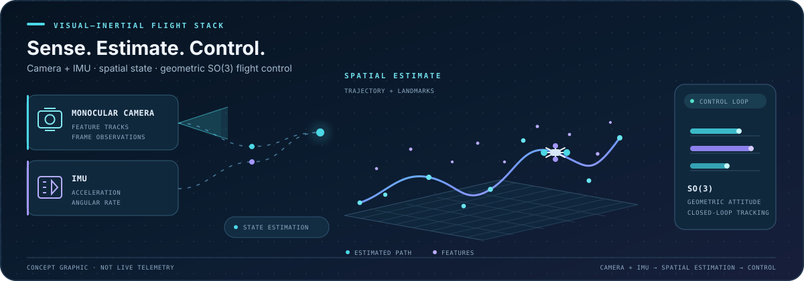
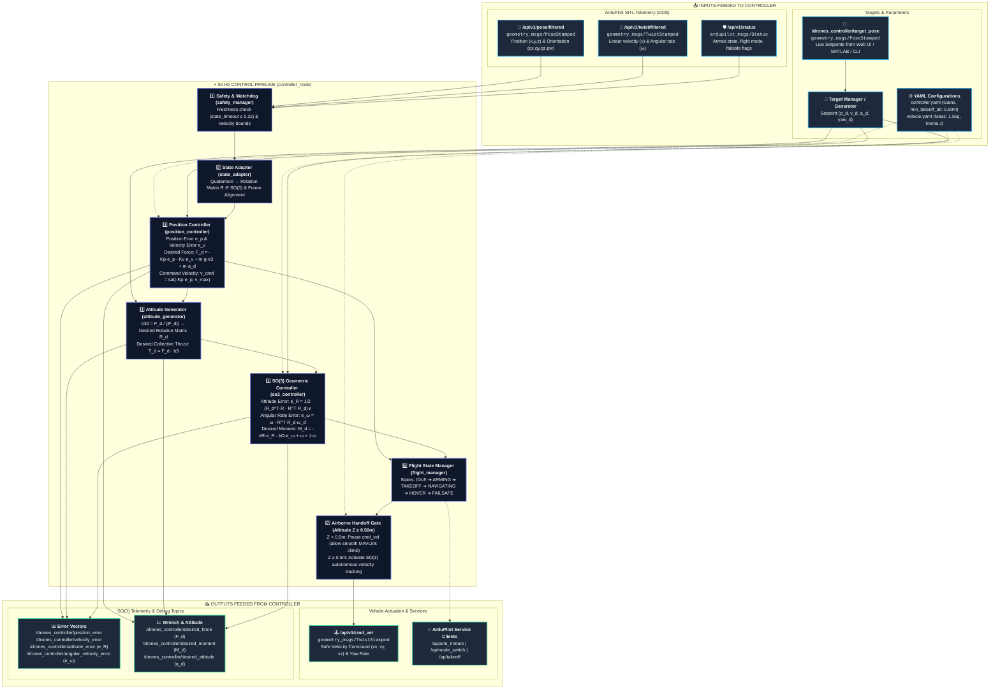
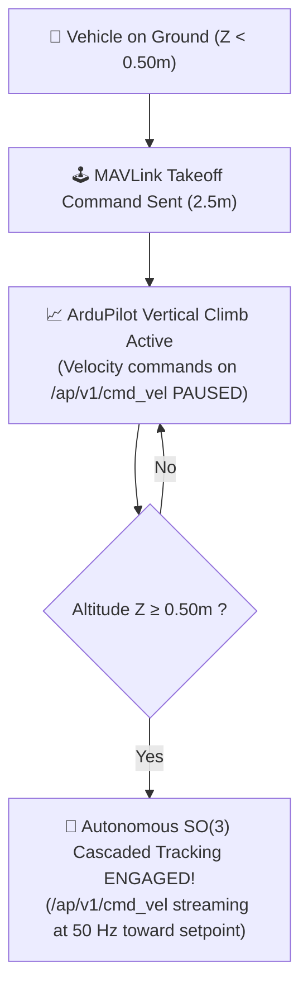

# 🛸 Drones Controller (SO(3) Geometric & Closed-Loop Autonomous Flight)

ROS 2 package providing high-precision **closed-loop 3D trajectory tracking** and **geometric $SO(3)$ attitude control** for autonomous multicopters interfaced with **ArduPilot SITL** and **Gazebo** over ROS 2 / micro-ROS (DDS).
<p align="center">
  
  
  
  
</p>

<p align="center">
  
</p>

---

## 🔄 Controller Workflow & Architecture

The controller operates as a dual-loop cascaded system at **50 Hz**: an outer-loop **Position Controller** generating desired forces and velocity commands, paired with an inner-loop **Geometric $SO(3)$ Controller** for full non-linear attitude tracking and telemetry.



---

## 📊 Inputs & Outputs Specification

### 📥 Inputs Feeded to Controller

| Source / Topic | Message Type | Rate | Description / Use Case |
| :--- | :--- | :--- | :--- |
| `/drones_controller/target_pose` | `geometry_msgs/msg/PoseStamped` | Event | Dynamic target setpoint $(x_d, y_d, z_d, \psi_d)$ dispatched from Web UI, MATLAB, or CLI. |
| `/ap/v1/pose/filtered` | `geometry_msgs/msg/PoseStamped` | 50 Hz | Current estimated position $(x, y, z)$ and orientation quaternion $(q_x, q_y, q_z, q_w)$. |
| `/ap/v1/twist/filtered` | `geometry_msgs/msg/TwistStamped` | 50 Hz | Vehicle linear velocities $(v_x, v_y, v_z)$ and body angular rates $(\omega_x, \omega_y, \omega_z)$. |
| `/ap/v1/status` | `ardupilot_msgs/msg/Status` | 10 Hz | ArduPilot armed state, flight mode (GUIDED), and failsafe flags. |
| `target.*` / Waypoints | ROS Parameters / Target Manager | Event | Static fallback target setpoint $(x_d, y_d, z_d, \psi_d)$ in `controller.yaml`. |
| `config/controller.yaml` | YAML Parameters | Static | $K_p$, $K_v$, $k_R$, $k_\Omega$ gains, velocity limit ($0.5\text{ m/s}$), tolerances ($0.10\text{ m}$), and `min_takeoff_altitude` ($0.50\text{ m}$). |
| `config/vehicle.yaml` | YAML Parameters | Static | Vehicle physical properties: Mass ($1.5\text{ kg}$), Inertia matrix $J = \text{diag}(0.02, 0.02, 0.04)$. |

### 📤 Outputs Feeded from Controller

| Destination / Topic | Message Type | Rate | Description / Action |
| :--- | :--- | :--- | :--- |
| `/ap/v1/cmd_vel` | `geometry_msgs/msg/TwistStamped` | 50 Hz | Autonomous velocity setpoint vector $(v_x, v_y, v_z)$ and yaw rate $\dot{\psi}$ sent to ArduPilot (active once airborne). |
| `/ap/arm_motors` | `ardupilot_msgs/srv/ArmMotors` | Event | Service client to arm quadrotor motors. |
| `/ap/mode_switch` | `ardupilot_msgs/srv/ModeSwitch` | Event | Service client to switch vehicle mode to `GUIDED`. |
| `/ap/takeoff` | `ardupilot_msgs/srv/Takeoff` | Event | Service client initiating autonomous vertical takeoff. |
| `/drones_controller/position_error` | `geometry_msgs/msg/Vector3Stamped` | 50 Hz | Tracking error vector $e_p = p - p_d$ in meters. |
| `/drones_controller/velocity_error` | `geometry_msgs/msg/Vector3Stamped` | 50 Hz | Velocity tracking error $e_v = v - v_d$ in m/s. |
| `/drones_controller/desired_force` | `geometry_msgs/msg/Vector3Stamped` | 50 Hz | Computed 3D total thrust force vector $F_d$ in Newtons. |
| `/drones_controller/desired_moment` | `geometry_msgs/msg/Vector3Stamped` | 50 Hz | Computed 3-axis SO(3) control moment $M_d$ in N·m. |
| `/drones_controller/attitude_error` | `geometry_msgs/msg/Vector3Stamped` | 50 Hz | Non-linear rotation error $e_R = \frac{1}{2}(R_d^T R - R^T R_d)^\vee$. |
| `/drones_controller/angular_velocity_error` | `geometry_msgs/msg/Vector3Stamped` | 50 Hz | Angular rate error vector $e_\Omega = \omega - R^T R_d \omega_d$. |
| `/drones_controller/desired_attitude` | `geometry_msgs/msg/PoseStamped` | 50 Hz | Desired target orientation quaternion $q_d$. |

---

## 🛫 Ground-to-Air Airborne Handoff Mechanism

During autonomous takeoff from a Gazebo runway or physical landing pad, commanding horizontal/vertical velocities on `/ap/v1/cmd_vel` while the vehicle skids touch the ground causes severe ground-effect instability, friction lockup, and premature tipping.

To solve this, the controller implements an **Automatic Airborne Handoff Gate**:



1. **Ground Safety State ($Z < 0.50\text{ m}$):**
   - Velocity commands on `/ap/v1/cmd_vel` are paused.
   - ArduPilot executes its native vertical climb (`MAV_CMD_NAV_TAKEOFF`) without fighting velocity setpoints.
2. **Airborne Transition ($Z \ge 0.50\text{ m}$):**
   - The controller detects that the quadrotor is safely airborne.
   - 50 Hz $SO(3)$ cascaded tracking automatically engages and steers the quadrotor to target waypoint $(x_d, y_d, z_d, \psi_d)$.

---

## 🗂️ Folder Structure

```text
.
├── config/
│   ├── controller.yaml              # Controller gains, update rate, tolerances, safety limits
│   └── vehicle.yaml                 # Physical quadrotor parameters (mass, gravity, inertia)
├── drones_controller/               # Python core modules
│   ├── __init__.py
│   ├── controller_node.py           # Main ROS 2 50 Hz closed-loop control node
│   ├── ardupilot_interface.py       # DDS/ROS 2 interface for ArduPilot topics and services
│   ├── target_manager.py            # Target position & setpoint manager
│   ├── trajectory_generator.py      # Analytical waypoint & path generator
│   ├── position_controller.py       # Outer-loop PID/PD position & velocity controller
│   ├── attitude_generator.py        # Generates desired rotation matrix R_d & collective thrust
│   ├── so3_controller.py            # Lie-algebraic SO(3) geometric attitude controller
│   ├── flight_manager.py            # Flight state machine (IDLE, TAKEOFF, NAVIGATING, HOVER)
│   ├── safety_manager.py            # Watchdog, command saturation, and failsafe enforcement
│   ├── state_adapter.py             # Quaternion ↔ SO(3) rotation matrix conversion
│   ├── command_interface.py         # Formats and safely dispatches commands to ArduPilot
│   ├── telemetry_logger.py          # Real-time state, error, and wrench logging
│   ├── frame_converter.py           # ENU ↔ NED coordinate transformation utilities
│   └── teleop.py                    # Keyboard teleoperation utility node
├── launch/
│   ├── controller.launch.py         # Standard controller launch file with parameters
│   └── simulation_controller.launch.py # Full simulation launch file
├── resource/
│   └── drones_controller            # Ament index package marker
├── test/                            # Automated pytest unit test suite
│   ├── test_attitude_generator.py
│   ├── test_frame_converter.py
│   ├── test_position_controller.py
│   └── test_so3_controller.py
├── .gitignore                       # Clean ignore rules (excludes pycache, build, logs)
├── LICENSE                          # Project license
├── package.xml                      # ROS 2 package manifest and dependencies
├── setup.cfg                        # Executable script install directives
├── setup.py                         # ROS 2 Python package installer
└── README.md                        # Documentation and architecture workflow
```

---

## 🚀 Quickstart & End-to-End Simulation

### 1. Build & Test Package

Build `drones_controller` and run unit tests inside your workspace:
```bash
cd ~/ardu_ws
colcon build --packages-select drones_controller
source install/setup.bash

# Run automated pytest verification
colcon test --packages-select drones_controller
colcon test-result --verbose
```

---

### 2. Full 3-Terminal Launch Sequence

To run the complete autonomous simulation with Gazebo Harmonic, ArduPilot SITL, and the AeroVIO Ground Station:

#### Terminal 1 — Gazebo Harmonic & ArduPilot SITL
```bash
source /opt/ros/humble/setup.bash
source ~/ardu_ws/install/setup.bash
export ROS_DOMAIN_ID=0
export RMW_IMPLEMENTATION=rmw_fastrtps_cpp

ros2 launch ardupilot_gz_bringup iris_runway.launch.py
```

#### Terminal 2 — SO(3) Cascaded Autonomous Controller
```bash
source /opt/ros/humble/setup.bash
source ~/ardu_ws/install/setup.bash
export ROS_DOMAIN_ID=0
export RMW_IMPLEMENTATION=rmw_fastrtps_cpp

ros2 launch drones_controller controller.launch.py
```
> *The node starts at 50 Hz, initializes the state adapter and watchdog, listens on `/drones_controller/target_pose`, and enters airborne standby.*

#### Terminal 3 — AeroVIO Ground Station & MAVLink Commander
```bash
source /opt/ros/humble/setup.bash
source ~/ardu_ws/install/setup.bash
cd ~/ardu_ws/src/Drones-Dashboard

python3 bridge_server.py --host 0.0.0.0 --port 8000 --mode live
```

---

### 3. Dynamic Waypoint Commanding

Target waypoints can be dispatched dynamically in real time through multiple interfaces:

#### Option A: AeroVIO Ground Station UI (Recommended)
Open **`http://localhost:8000`** (or `http://<HOST_IP>:8000` from any phone or secondary PC):
1. Click **`MODE: GUIDED`**
2. Click **`ARM MOTORS`**
3. Click **`TAKEOFF (2.5M)`** (drone climbs cleanly; airborne handoff engages automatically at $Z \ge 0.50\text{ m}$)
4. Enter target coordinates $(X, Y, Z, \text{Yaw})$ and click **`DISPATCH TARGET`**

#### Option B: ROS 2 Command-Line Interface
Publish directly to `/drones_controller/target_pose`:
```bash
ros2 topic pub --once /drones_controller/target_pose geometry_msgs/msg/PoseStamped "{
  header: {stamp: {sec: 0, nanosec: 0}, frame_id: 'map'},
  pose: {
    position: {x: 20.0, y: 5.0, z: 20.0},
    orientation: {x: 0.0, y: 0.0, z: 0.8415, w: 0.5403}
  }
}"
```

#### Option C: MATLAB ROS Toolbox (LAN / Mobile Hotspot)
Connect a secondary computer running MATLAB on the same Wi-Fi / hotspot:
```matlab
% Set ROS 2 Domain ID matching the simulation
setenv('ROS_DOMAIN_ID', '0');

targetNode = ros2node("/matlab_target_publisher");
targetPub = ros2publisher(targetNode, "/drones_controller/target_pose", "geometry_msgs/PoseStamped");

msg = ros2message(targetPub);
msg.header.frame_id = 'map';
msg.pose.position.x = 15.0;
msg.pose.position.y = 8.0;
msg.pose.position.z = 10.0;
msg.pose.orientation.w = 1.0;

send(targetPub, msg);
```

---

### 4. 8BitDo Ultimate 2C / Gamepad Teleoperation (Local ROS 2)

You can fly the drone directly in the local simulation using an **8BitDo Ultimate 2C Wireless/Wired** or any standard gamepad:

```bash
source /opt/ros/humble/setup.bash
source ~/ardu_ws/install/setup.bash

ros2 launch drones_controller joystick_teleop.launch.py
```
> *Auto-detects the 8BitDo controller at `/dev/input/js1` (or `js0`), connects via MAVLink UDP 14550, and displays a live terminal HUD showing real-time stick deflections.*

#### Controller Button & Stick Bindings:
- **Left Stick (Vertical):** Throttle / Climb ($+V_z$) & Descend ($-V_z$)
- **Left Stick (Horizontal):** Yaw Rotation Rate ($\pm\dot{\psi}$)
- **Right Stick (Vertical):** Pitch / Forward ($+V_x$) & Reverse ($-V_x$)
- **Right Stick (Horizontal):** Roll / Strafe Left ($+V_y$) & Strafe Right ($-V_y$)
- **Button Y:** Switch mode to `GUIDED` (Mode 4)
- **Button A:** `ARM` Throttle (Motors)
- **Button X:** `TAKEOFF` to 5.0m
- **Button B:** `BRAKE` / Hover Hold (Zero velocity)
- **LB / RB:** Precision mode ($0.5\text{ m/s}$) / Turbo mode ($2.0\text{ m/s}$)

---

### 5. FastDDS Network Whitelist (Distributed Setup)

If communicating across multiple devices on a personal hotspot or Wi-Fi network, ensure your IP address is registered in `~/fastdds_whitelist.xml`:
```bash
export FASTRTPS_DEFAULT_PROFILES_FILE=~/fastdds_whitelist.xml
export RMW_IMPLEMENTATION=rmw_fastrtps_cpp
```
