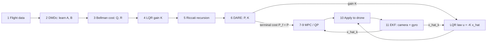
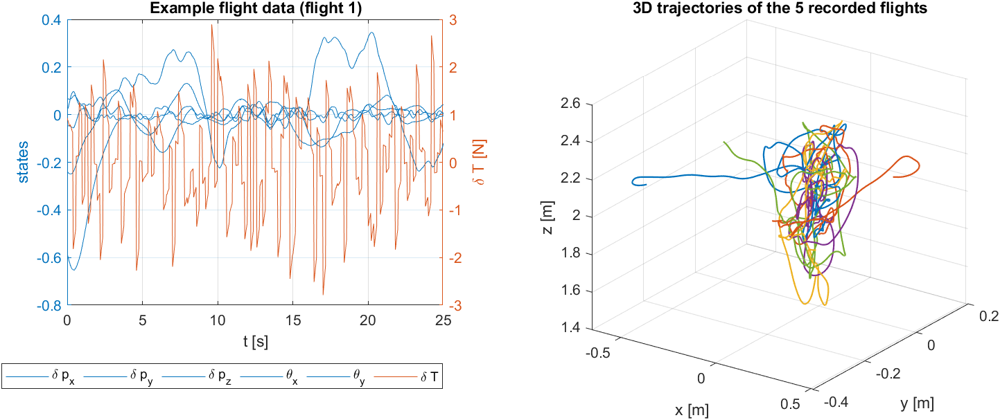
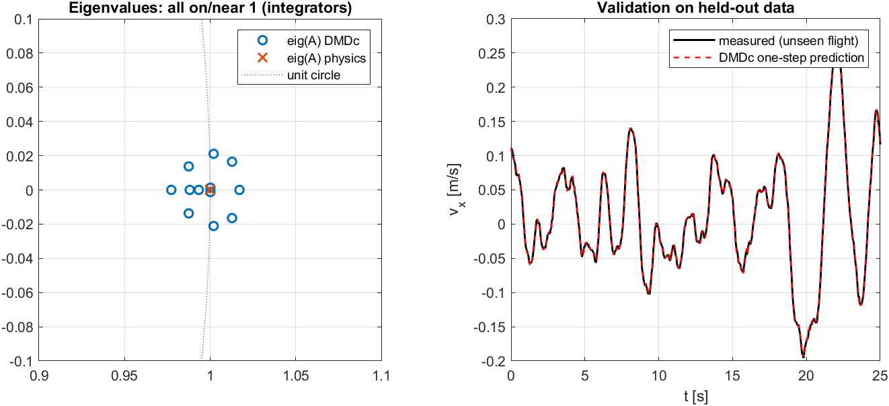
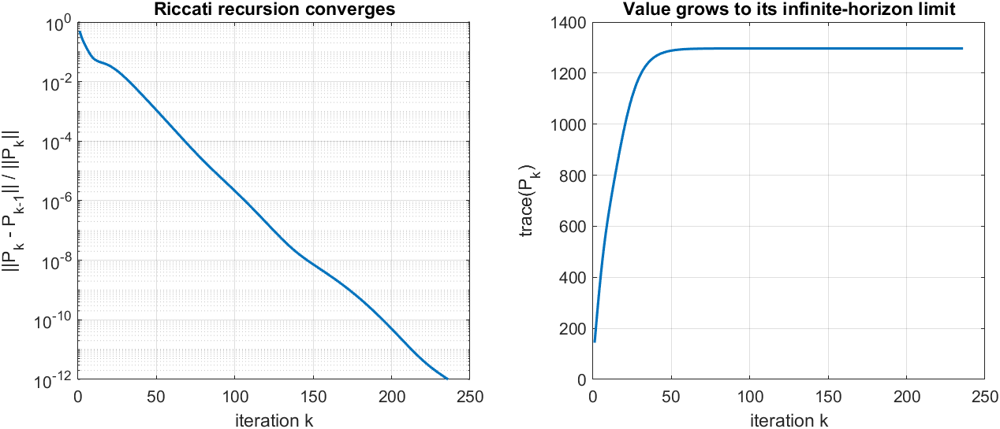
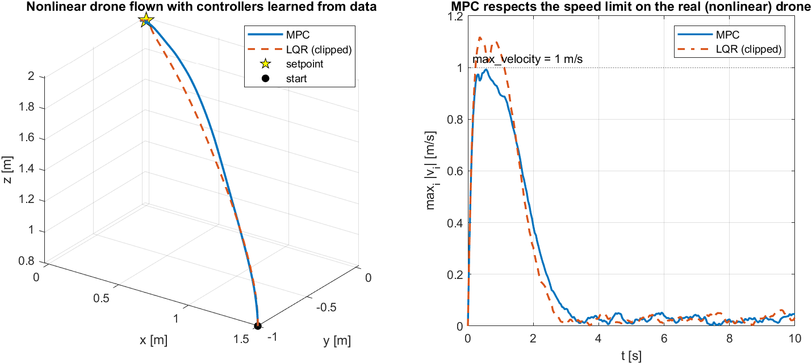
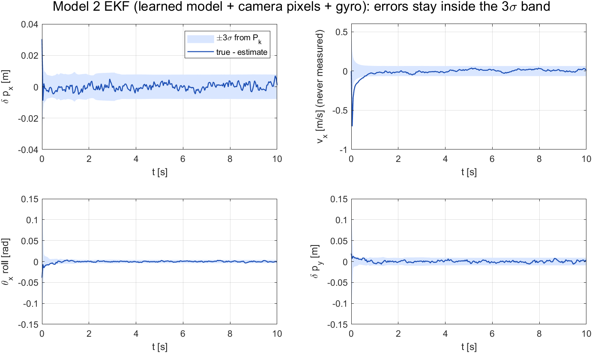
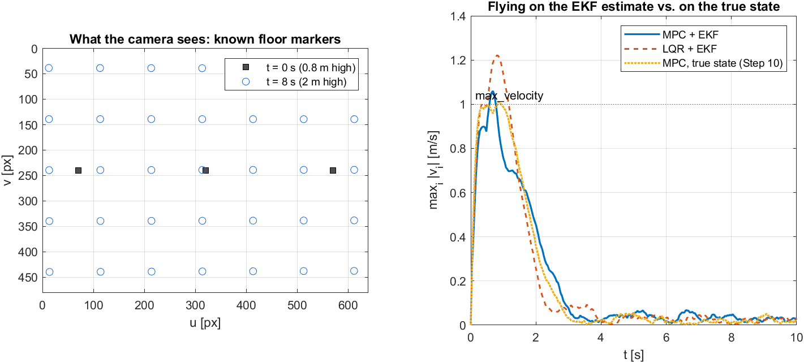

<div align="center">


# 3D Environment Mapping & Monocular Visual-Inertial Odometry

### Geometric Control for Autonomous Multirotor UAVs

**Group CD2 · Amrita Vishwa Vidyapeetham, Coimbatore**

[](https://docs.ros.org/en/humble/index.html)
[](https://www.python.org/)
[](https://ardupilot.org/dev/docs/sitl-simulator-software-in-the-loop.html)
[](https://gazebosim.org/)
[](https://www.mathworks.com/products/ros.html)
[](LICENSE)

**Explore the project:** [Controller](#-controller-at-a-glance) · [Architecture](#-system-architecture) · [Quick start](#-quick-start) · [Results](#-results--visual-evidence) · [Team](#-team)

</div>


## 👥 Team

| Name | Roll number |
| --- | --- |
| Ravishanmugam K | `CB.SC.U4AIE24347` |
| Ishwarya Murugesan | `CB.SC.U4AIE24220` |
| Aparna Bharani | `CB.SC.U4AIE24304` |
| Cibikumar B | `CB.SC.U4AIE24212` |
| Akhilan S | `CB.SC.U4AIE24362` |

---

> [!IMPORTANT]
> **Implementation scope:** The current committed ROS 2 implementation focuses on SO(3) geometric control and ArduPilot topic integration. Monocular VIO and full 3D reconstruction are project goals/research context; this README does not present them as completed ROS 2 modules.

## ✨ Overview

Drones operating indoors or in GPS-denied environments need reliable state estimation, position control, and a useful representation of the surrounding space. This project explores that broader challenge while implementing a modular multirotor controller built around **rotation matrices and geometric attitude control on SO(3)**.

The repository combines a ROS 2 Python package, an ArduPilot SITL/Gazebo interface, MATLAB live scripts for staged modelling and experimentation, and saved result images.

### What is in this repository?

| Area | Current contents |
| --- | --- |
| **Geometric control** | Position/velocity error calculation, desired-force and attitude construction, SO(3) attitude errors, and moment-control calculations |
| **ROS 2 integration** | Controller node that consumes filtered pose/twist state and publishes velocity commands plus diagnostics |
| **Simulation workflow** | ArduPilot SITL and Gazebo integration context |
| **MATLAB experiments** | Staged live scripts covering waypoints, trajectories, synthetic sensors, state estimation, controller logic, dynamics, and results |
| **Mapping & VIO** | Project objective and research direction; dedicated end-to-end perception/mapping nodes are not currently included in the main ROS 2 package |

## 🚁 Controller at a glance

The controller avoids Euler angles as its internal attitude representation. It uses rotation matrices to represent orientation and computes geometric tracking errors to form control quantities.

- **Position and velocity feedback** to track a desired state.
- **SO(3) attitude handling** using desired rotation matrices and geometric attitude error.
- **Configurable gains and setpoints** stored in `drones_controller/config/controller.yaml`.
- **ROS 2 diagnostics** for position error, velocity error, desired force/moment, attitude error, and desired attitude.
- **Command gating**: `enable_command` defaults to `false` in the supplied configuration.

## 🧭 System architecture

The animated architecture diagram is maintained as a standalone SVG so it can be previewed and edited independently of this README. Animated nodes, connectors, and traveling dots illustrate the flow from simulation and ROS 2 state topics through the SO(3) controller to command output and diagnostics.


**Control loop, simplified**

1. Read the filtered pose and twist state from ROS 2 topics.
2. Compare measured position and velocity with the desired state.
3. Compute desired force and construct a target attitude.
4. Calculate geometric attitude and angular-velocity errors.
5. Publish diagnostics and a bounded velocity command through the configured interface.

> [!NOTE]
> The controller's force and moment calculations are geometric-control quantities. The currently configured command interface publishes a `geometry_msgs/TwistStamped` velocity command; do not interpret the diagnostics as direct motor-level actuator outputs.

## 🛠️ Technology stack

| Technology | Role |
| --- | --- |
| [ROS 2 Humble](https://docs.ros.org/en/humble/index.html) | Nodes, messages, topics, and runtime integration |
| [ArduPilot SITL](https://ardupilot.org/dev/docs/sitl-simulator-software-in-the-loop.html) | Software-in-the-loop flight stack and vehicle interface |
| [Gazebo](https://gazebosim.org/) | Simulation environment |
| Python + NumPy | Controller implementation and numerical linear algebra |
| MATLAB Live Scripts | Staged modelling and controller experiments |

## 🚀 Quick start

These steps build the `drones_controller` package inside an existing ROS 2 workspace. They do **not** install or launch ArduPilot or Gazebo for you.

### Prerequisites

- A working ROS 2 installation compatible with the workspace (the project uses ROS 2 Humble).
- Python dependencies declared by the package, including NumPy.
- A configured ArduPilot SITL/DDS and simulation environment if you intend to connect to the vehicle topics.
- `colcon` installed in your ROS 2 environment.

### 1. Put the package in your workspace

The package directory should be inside your workspace's `src/` directory. For example:

```bash
mkdir -p ~/drones_ws/src
cd ~/drones_ws/src
git clone https://github.com/Ravish2807/Drones_S5_CD2_3D_Mapping_using_normal_monocular_camera_controlling_Visual-Inertial-Odometry-VIO.git
```

If you already cloned this repository, use that local checkout instead of cloning it again.

### 2. Build the controller

```bash
cd ~/drones_ws
source /opt/ros/humble/setup.bash
colcon build --symlink-install --packages-select drones_controller
source install/setup.bash
```

### 3. Inspect available executables

```bash
ros2 pkg executables drones_controller
```

The package declares these console entry points:

- `controller_node` — the geometric controller node.
- `teleop` — keyboard velocity teleoperation.

### 4. Check topics before running

Start your configured simulation and DDS bridge, then inspect the topics actually available in your environment:

```bash
ros2 topic list
ros2 topic info /ap/v1/pose/filtered
ros2 topic info /ap/v1/twist/filtered
```

The controller defaults to these topic names, which can be changed via ROS parameters:

| Parameter | Default | Purpose |
| --- | --- | --- |
| `pose_topic` | `/ap/v1/pose/filtered` | Filtered pose input |
| `twist_topic` | `/ap/v1/twist/filtered` | Filtered velocity input |
| `cmd_vel_topic` | `/ap/v1/cmd_vel` | Velocity command output |
| `control_rate` | `25.0` | Controller timer frequency in Hz |
| `desired_x`, `desired_y`, `desired_z` | `0.0`, `0.0`, `2.0` | Desired position |
| `desired_yaw` | `0.0` | Desired heading |
| `max_velocity` | `1.0` | Velocity command limit configured by the node |
| `state_timeout` | `0.5` | Maximum state age used by the controller |
| `enable_command` | `false` | Command publishing gate |

> [!WARNING]
> **Safety first:** Keep command publishing disabled while checking the topics and controller setup. Before enabling commands, verify the simulation, coordinate frames, topic remappings, setpoints, and emergency-stop procedure. Test in simulation before considering any physical vehicle.

## ⚙️ Configuration

Controller parameters live in [`drones_controller/config/controller.yaml`](drones_controller/config/controller.yaml). The file includes:

- Vehicle mass and gravity.
- Position/velocity gains (`kp`, `kv`).
- Attitude/angular-rate gains (`kR`, `kOmega`).
- Diagonal inertia values.
- Desired position and yaw.
- Command rate, velocity limit, state timeout, and command enable flag.

Treat the supplied values as example configuration, not as validated gains for every aircraft. Confirm units, frame conventions, and model assumptions for your vehicle before flight.

## 🧪 MATLAB toy-model workflow

The `Toy Model/` directory contains a staged set of MATLAB Live Scripts:

| Step | Script | Focus |
| --- | --- | --- |
| 1 | `step1_waypoints.mlx` | Waypoints |
| 2 | `step2_trajectory.mlx` | Trajectory generation |
| 3 | `step3_synthetic_sensors.mlx` | Synthetic sensing |
| 4 | `step4_state_estimation.mlx` | State estimation |
| 5 | `step5_so3_controller.mlx` | SO(3) controller |
| 6 | `step6_drone_dynamics.mlx` | Drone dynamics |
| 7 | `step7_final_results.mlx` | Final experiment/results |

Open the scripts in MATLAB to inspect the assumptions and execute the stages supported by your installed toolboxes.


## 🖼️ Results & Visual Evidence

Selected simulation and controller results are shown below.

<table>
  <tr>
    <th align="center" width="50%">Result 2</th>
    <th align="center" width="50%">Result 3</th>
  </tr>
  <tr>
    <td align="center" width="50%">
      
    </td>
    <td align="center" width="50%">
      
    </td>
  </tr>
</table>

### 🎥 SO(3) Target-Point Flight Demonstration

<video src="https://github.com/user-attachments/assets/9868e487-e9f7-4664-9d9b-47bc433d0293" controls muted loop playsinline width="100%">
  Your browser does not support embedded video. [Watch the SO(3) target-point flight demonstration](https://github.com/user-attachments/assets/9868e487-e9f7-4664-9d9b-47bc433d0293).
</video>

**Video:** [SO3_TARGET(pt)_FLYING.webm](https://github.com/user-attachments/assets/9868e487-e9f7-4664-9d9b-47bc433d0293)


## 📐 Key state and control quantities

| Quantity | Meaning |
| --- | --- |
| Position, `p = (x, y, z)` | Vehicle position in the configured local frame |
| Linear velocity, `v` | Translational velocity feedback |
| Orientation | Rotation-matrix representation used for geometric attitude control |
| Rotation matrix, `R ∈ SO(3)` | Geometric attitude representation |
| Desired force, `F_d` | Translational-control output |
| Desired moment, `M_d` | Geometric attitude-control quantity |
| Position/velocity/attitude errors | Published controller diagnostics |

## 📐Control Logic: Data-Driven Model and LQR


1. It learns a discrete-time linear model of the drone from data (blocks 1–2).
2. It designs an infinite-horizon optimal controller (LQR) on that model (blocks 3–6).
3. It extends the controller to a constrained MPC (blocks 7–9).
4. It flies the real, nonlinear drone with the result (block 10).
5. It closes the loop with an Extended Kalman Filter that rebuilds the state from camera pixels and the gyroscope (block 11).

This section derives blocks 1–6. Blocks 7–9 are covered in the [MPC formulation](#-model-predictive-control-mpc-mathematical-formulation) below. Blocks 10–11 are in [Applying the Control and EKF State Estimation](#-model-2-control-logic-applying-the-control-and-ekf-state-estimation), which follows the MPC section.



### Notation used 

| Symbol | Meaning | Size | Units |
| --- | --- | --- | --- |
| $`x_k`$ | state deviation from hover at sample $`k`$ | $`\mathbb{R}^{12}`$ | m, m/s, rad, rad/s |
| $`u_k`$ | input deviation from hover at sample $`k`$ | $`\mathbb{R}^{4}`$ | N, N m |
| $`\Delta t`$ | sample time (25 Hz `control_rate`) | scalar | s (0.04) |
| $`p_{\mathrm{ref}}`$ | hover set-point | $`\mathbb{R}^{3}`$ | m, $`[0,0,2]^T`$ |
| $`u_{\mathrm{trim}}`$ | hover input $`[mg_0,0,0,0]^T`$ | $`\mathbb{R}^{4}`$ | N, N m |
| $`A,\ B`$ | learned discrete-time model | $`\mathbb{R}^{12\times12},\ \mathbb{R}^{12\times4}`$ | – |
| $`Q,\ R`$ | LQR/MPC state and input weights | $`\mathbb{R}^{12\times12},\ \mathbb{R}^{4\times4}`$ | 1/(unit)² |
| $`P`$ | value matrix, $`V(x)=x^TPx`$ | $`\mathbb{R}^{12\times12}`$ | as $`Q`$ |
| $`K`$ | LQR state-feedback gain | $`\mathbb{R}^{4\times12}`$ | mixed |
| $`\hat{x}_k,\ \Sigma_k`$ | EKF estimate and its error covariance | $`\mathbb{R}^{12},\ \mathbb{R}^{12\times12}`$ | – |
| $`Q_e,\ R_n,\ L`$ | EKF process noise, measurement noise, estimator gain | – | – |
| $`[a]_\times`$ | skew matrix, $`[a]_\times b=a\times b`$ | $`\mathbb{R}^{3\times3}`$ | – |

LQR already uses $`P`$, $`Q`$ and $`K`$. To avoid a clash, the EKF writes its covariance as $`\Sigma`$, its process noise as $`Q_e`$ and its gain as $`L`$. This matches item 10 of the MPC section. All matrices in Model 2 are **discrete-time**.

### 1. Nonlinear plant and flight data (M2.1)

**Plant.** The drone is a rigid body with an ENU world frame and an FLU body frame. Its equations are the same as Model 1 (M1.1–M1.4):

```math
\dot{p}=v,\qquad
\dot{v}=g+\frac{T}{m}Re_3,\qquad
\dot{R}=R[\omega]_\times,\qquad
\dot{\omega}=J^{-1}\left(\tau-\omega\times J\omega\right),
```

with $`g=[0,0,-g_0]^T`$, $`e_3=[0,0,1]^T`$, $`m=1.5`$ kg and $`J=\mathrm{diag}(0.02,0.02,0.04)`$ kg m². These values come from `controller.yaml`.

**Operating point.** Hover is an equilibrium. With $`p=p_{\mathrm{ref}}`$, $`v=0`$, $`R=I`$, $`\omega=0`$, $`T=mg_0`$ and $`\tau=0`$, every time derivative above is zero.

**Sampled deviation state and input (M2.1).**

```math
\boxed{
x_k=\begin{bmatrix}p(t_k)-p_{\mathrm{ref}}\\ v(t_k)\\ \boldsymbol{\theta}(t_k)\\ \omega(t_k)\end{bmatrix}\in\mathbb{R}^{12},\qquad
u_k=\begin{bmatrix}T(t_k)-mg_0\\ \tau(t_k)\end{bmatrix}\in\mathbb{R}^{4},\qquad
t_k=k\Delta t
}
```

Here $`\boldsymbol{\theta}=\mathrm{Log}(R)\in\mathbb{R}^3`$ is the rotation vector, so that $`R=\mathrm{Exp}(\boldsymbol{\theta})=\exp([\boldsymbol{\theta}]_\times)`$. Near hover, $`\boldsymbol{\theta}\approx(\phi,\theta,\psi)`$, the small roll/pitch/yaw angles used in item 2 of the MPC section. $`\mathrm{Log}`$ turns the $`3\times3`$ rotation (9 numbers, 3 degrees of freedom) into a plain 3-vector, which is what DMDc, LQR and MPC need.

**Why deviations?** Linearizing about hover gives $`\delta\dot{x}=A_c\,\delta x+B_c\,\delta u`$ with **no constant term**. With the raw thrust $`T`$, gravity would appear as a constant offset $`mg_0`$, and the form $`x_{k+1}=Ax_k+Bu_k`$ cannot represent that.

**Physics reference (what DMDc should recover).** At hover, the Jacobians of the plant are

```math
A_c=\begin{bmatrix}0&I&0&0\\0&0&-g_0[e_3]_\times&0\\0&0&0&I\\0&0&0&0\end{bmatrix},\qquad
B_c=\begin{bmatrix}0&0\\ e_3/m&0\\0&0\\0&J^{-1}\end{bmatrix},\qquad
-g_0[e_3]_\times=\begin{bmatrix}0&g_0&0\\-g_0&0&0\\0&0&0\end{bmatrix},
```

so $`\dot{v}_x=g_0\theta_y`$ and $`\dot{v}_y=-g_0\theta_x`$: the drone tilts to accelerate sideways. The zero-order-hold discretization is

```math
\exp\left(\begin{bmatrix}A_c&B_c\\0&0\end{bmatrix}\Delta t\right)=\begin{bmatrix}A_{\mathrm{phys}}&B_{\mathrm{phys}}\\0&I\end{bmatrix},\qquad
A_{\mathrm{phys}}=e^{A_c\Delta t},\quad B_{\mathrm{phys}}=\int_0^{\Delta t}e^{A_cs}\,ds\;B_c .
```

Model 2 never uses these matrices to control. They serve only to check the learned model.

**Persistent excitation.** A free quadrotor is unstable, so data is always recorded with a stabilizing pilot in the loop. Here that pilot is a small-angle PD law, playing the role ArduPilot has in SITL:

```math
a_{\mathrm{cmd}}=-1.0\,\delta p-1.5\,v,\qquad
\boldsymbol{\theta}_d=\begin{bmatrix}-a_{\mathrm{cmd},y}/g_0\\ a_{\mathrm{cmd},x}/g_0\\ 0\end{bmatrix},\qquad
u^{\mathrm{pilot}}_k=\begin{bmatrix}m\,a_{\mathrm{cmd},z}\\ J\left(-36(\boldsymbol{\theta}-\boldsymbol{\theta}_d)-10\,\omega\right)\end{bmatrix},
```

```math
u_k=u^{\mathrm{pilot}}_k+e_k,\qquad
\lvert e_k\rvert\le\begin{bmatrix}2\ \mathrm{N}&0.03\ \mathrm{N\,m}&0.03\ \mathrm{N\,m}&0.01\ \mathrm{N\,m}\end{bmatrix}^T .
```

The excitation $`e_k`$ is drawn uniformly and held for 5 samples (0.2 s). It is needed because pure feedback, $`u_k=-K_0x_k`$, would make every row of $`U`$ a linear combination of the rows of $`X`$. The data could then never separate "the drone" ($`A`$) from "the pilot" ($`K_0`$), and $`\begin{bmatrix}X\\U\end{bmatrix}`$ would have rank at most 12 instead of 16.

**Recorded data set.** The toy model records 5 flights of 25 s each at 25 Hz, which is 625 transitions per flight. The physics is integrated with RK4 at 200 Hz, with wind gusts and small logging noise. Flights 1–4 give 2500 snapshots for identification, and flight 5 is held out for validation. The largest roll/pitch in the data is 6.46°, well inside the near-linear regime.



### 2. DMDc: learning A and B from data (M2.2–M2.4)

```math
\boxed{
X=\begin{bmatrix}x_1&\cdots&x_{M}\end{bmatrix},\quad
X^+=\begin{bmatrix}x_2&\cdots&x_{M+1}\end{bmatrix},\quad
U=\begin{bmatrix}u_1&\cdots&u_{M}\end{bmatrix}
}
\qquad\text{(M2.2)}
```

```math
\boxed{\begin{bmatrix}A&B\end{bmatrix}=X^+\begin{bmatrix}X\\U\end{bmatrix}^{\dagger}}
\qquad\text{(M2.3)}
\qquad\qquad
\boxed{x_{k+1}\approx Ax_k+Bu_k}
\qquad\text{(M2.4)}
```

Here $`M`$ is the number of recorded transitions (2500), $`X,X^+\in\mathbb{R}^{12\times M}`$ and $`U\in\mathbb{R}^{4\times M}`$. With several flights, the snapshot matrices of each flight are concatenated column-wise, and no column pairs the last sample of one flight with the first sample of the next.

**Derivation.** Let $`G=\begin{bmatrix}A&B\end{bmatrix}\in\mathbb{R}^{12\times16}`$ and $`\Omega=\begin{bmatrix}X\\U\end{bmatrix}\in\mathbb{R}^{16\times M}`$. Then $`x_{k+1}=G\begin{bmatrix}x_k\\u_k\end{bmatrix}`$ for every sample, or $`X^+\approx G\Omega`$ for all samples at once. The least-squares choice minimizes the sum of squared one-step prediction errors:

```math
\min_G\ \mathcal{F}(G)=\left\lVert X^+-G\Omega\right\rVert_F^2=\mathrm{tr}\left[(X^+-G\Omega)(X^+-G\Omega)^T\right].
```

Setting the matrix gradient to zero,

```math
\frac{\partial\mathcal{F}}{\partial G}=-2\left(X^+-G\Omega\right)\Omega^T=0
\quad\Longrightarrow\quad
G\,\Omega\Omega^T=X^+\Omega^T \quad\text{(normal equations)}.
```

When $`\Omega`$ has full row rank 16, which the excitation guarantees, the $`16\times16`$ matrix $`\Omega\Omega^T`$ is invertible, and

```math
G=X^+\Omega^T\left(\Omega\Omega^T\right)^{-1}=X^+\Omega^{\dagger},\qquad
A=G_{(:,1:12)},\quad B=G_{(:,13:16)} .
```

In practice, $`\Omega^\dagger`$ is computed from the SVD $`\Omega=W S V^T`$ as $`\Omega^\dagger=VS^{-1}W^T`$, and very small singular values can be truncated to suppress noise (Proctor, Brunton & Kutz, 2016).

**Worked scalar example.** The true system is $`x_{k+1}=0.9x_k+0.5u_k`$, and three noise-free steps are recorded: $`X=[1,\ 1.4,\ 0.76]`$, $`X^+=[1.4,\ 0.76,\ 0.934]`$, $`U=[1,\ -1,\ 0.5]`$.

```math
\Omega\Omega^T=\begin{bmatrix}3.5376&-0.02\\-0.02&2.25\end{bmatrix},\qquad
X^+\Omega^T=\begin{bmatrix}3.17384&1.107\end{bmatrix},
```

```math
\begin{bmatrix}a&b\end{bmatrix}=\frac{1}{7.9592}\begin{bmatrix}3.17384&1.107\end{bmatrix}\begin{bmatrix}2.25&0.02\\0.02&3.5376\end{bmatrix}=\begin{bmatrix}0.9000&0.5000\end{bmatrix}.
```

The true model is recovered exactly.

**On the drone (2500 snapshots).** $`\mathrm{rank}\Omega=16`$, the condition number of $`\Omega`$ is 409, and the relative one-step training residual is 1.83 %. The learned entries match the physics:

| Entry | Physical meaning | DMDc | Physics (ZOH) |
| --- | --- | ---: | ---: |
| $`A_{1,4}`$ | $`\Delta t`$ (position from velocity) | 0.0399 | 0.0400 |
| $`A_{4,8}`$ | $`\approx g_0\Delta t`$ ($`v_x`$ from pitch) | 0.3909 | 0.3924 |
| $`A_{5,7}`$ | $`\approx -g_0\Delta t`$ ($`v_y`$ from roll) | −0.3862 | −0.3924 |
| $`B_{6,1}`$ | $`\Delta t/m`$ ($`v_z`$ from thrust) | 0.0268 | 0.0267 |
| $`B_{10,2}`$ | $`\Delta t/J_x`$ (roll rate from roll torque) | 2.0007 | 2.0000 |
| $`B_{12,4}`$ | $`\Delta t/J_z`$ (yaw rate from yaw torque) | 1.0096 | 1.0000 |

The relative errors of the whole matrices are small: $`\lVert A-A_{\mathrm{phys}}\rVert_F/\lVert A_{\mathrm{phys}}\rVert_F=0.95\%`$ and $`\lVert B-B_{\mathrm{phys}}\rVert_F/\lVert B_{\mathrm{phys}}\rVert_F=0.81\%`$.

On the held-out flight, a 1-second (25-step) open-loop prediction misses the position by 1.21 cm, compared with 1.14 cm for the exact physics model. Physical parameters can also be read back from the learned model: mass $`\Delta t/B_{6,1}=1.49`$ kg and roll inertia $`\Delta t/B_{10,2}=0.0200`$ kg m².



### 3. Quadratic cost and the Bellman equation (M2.5–M2.7)

```math
\boxed{J=\sum_{k=0}^{\infty}\left(x_k^TQx_k+u_k^TRu_k\right)}
\qquad\text{(M2.5)}
```

```math
\boxed{V(x_k)=\min_{u_k}\left[x_k^TQx_k+u_k^TRu_k+V(x_{k+1})\right],\qquad x_{k+1}=Ax_k+Bu_k}
\qquad\text{(M2.6)}
```

```math
\boxed{V(x)=x^TPx}
\qquad\text{(M2.7)}
```

with $`Q=Q^T\succeq0`$, $`R=R^T\succ0`$ and $`P=P^T\succeq0`$. $`V(x)`$ is the *value function*: the lowest cost that can still be achieved starting from $`x`$.

**(M2.5) Choosing the weights: Bryson's rule.** Each weight is $`Q_{ii}=1/x_{i,\max}^2`$ and $`R_{jj}=1/u_{j,\max}^2`$, where $`x_{i,\max}`$ and $`u_{j,\max}`$ are the largest acceptable deviations. Every state or input at its limit then contributes the same cost, 1:

| Quantity | $`\delta p`$ [m] | $`v`$ [m/s] | roll, pitch [rad] | yaw [rad] | $`\omega`$ [rad/s] | $`\delta T`$ [N] | $`\tau_x,\tau_y`$ [N m] | $`\tau_z`$ [N m] |
| --- | --- | --- | --- | --- | --- | --- | --- | --- |
| max acceptable | 0.5 | 1.0 | 0.2 | 0.5 | 1.0 | 5 | 0.2 | 0.05 |
| weight | 4 | 1 | 25 | 4 | 1 | 0.04 | 25 | 400 |

The velocity limit of 1 m/s is the `max_velocity` of `controller.yaml`. Tilt and rate are weighted heavily because mapping with a camera needs smooth, blur-free motion.

**(M2.6) Principle of optimality.** Write the stage cost as $`\ell(x,u)=x^TQx+u^TRu`$ and split the infinite sum into the first step and the rest:

```math
V(x_k)=\min_{u_k,u_{k+1},\dots}\left[\ell(x_k,u_k)+\sum_{j>k}\ell(x_j,u_j)\right]
=\min_{u_k}\Big[\ell(x_k,u_k)+\underbrace{\min_{u_{k+1},\dots}\sum_{j>k}\ell(x_j,u_j)}_{V(x_{k+1})}\Big].
```

Whatever the first move is, the remaining moves must be optimal for the state it leads to. Otherwise they could be improved, which would lower the total. The infinite-dimensional problem therefore collapses to a one-step problem.

**(M2.7) The quadratic value function is self-consistent.** Assume $`V(x_{k+1})=x_{k+1}^TPx_{k+1}`$ and substitute $`x_{k+1}=Ax+Bu`$:

```math
x^TQx+u^TRu+(Ax+Bu)^TP(Ax+Bu)
=u^T\left(R+B^TPB\right)u+2u^TB^TPAx+x^T\left(Q+A^TPA\right)x .
```

This is quadratic in $`u`$. Its minimizer is linear in $`x`$ (block 4), and its minimum value is again a quadratic form in $`x`$ (block 5). The Bellman equation preserves the quadratic shape, so the only unknown left is the matrix $`P`$.

**Worked scalar example.** Take $`x_{k+1}=1.1x_k+0.5u_k`$ (open-loop unstable: it grows 10 % per step), $`q=r=1`$, the next-step value $`V(x)=x^2`$ and the current state $`x=1`$:

```math
\mathrm{RHS}(u)=1+u^2+(1.1+0.5u)^2,\qquad
\frac{d}{du}=2u+(1.1+0.5u)=0\ \Rightarrow\ u^{*}=-\frac{1.1}{2.5}=-0.44,\qquad
V(1)=1.968 .
```

**On the drone.** Take the DMDc model, $`V_{\mathrm{next}}=x^TQx`$, and a drone 50/30/20 cm off target. Brute-force minimization with `fminsearch` and the closed form both give $`u^{*}=[-0.0104,-0.0001,0.0001,0.0000]^T`$ with value 3.0393. Doing nothing ($`u=0`$) costs 14 593 after 10 s, and the cost keeps growing because the drone drifts.

### 4. Linear Quadratic Regulator (M2.8–M2.9)

```math
\boxed{K=\left(R+B^TPB\right)^{-1}B^TPA}
\qquad\text{(M2.8)}
\qquad\qquad
\boxed{u_k=-Kx_k}
\qquad\text{(M2.9)}
```

**Derivation.** Differentiate the bracket of (M2.6) with respect to $`u`$, using $`\partial(u^TMu)/\partial u=2Mu`$ for symmetric $`M`$:

```math
\frac{\partial}{\partial u}\left[x^TQx+u^TRu+(Ax+Bu)^TP(Ax+Bu)\right]=2Ru+2B^TP(Ax+Bu)=0
\quad\Longrightarrow\quad
\left(R+B^TPB\right)u=-B^TPA\,x .
```

Because $`R\succ0`$ and $`P\succeq0`$, the matrix $`R+B^TPB`$ is positive definite. It is therefore invertible, and since it is half the Hessian $`2(R+B^TPB)\succ0`$, the stationary point is the unique minimum. Hence $`u^{*}=-(R+B^TPB)^{-1}B^TPA\,x=-Kx`$.

**Closed loop.** $`x_{k+1}=(A-BK)x_k`$, which is stable if and only if the spectral radius satisfies $`\rho(A-BK)<1`$.

**Worked scalar example.** With the converged $`P=3.1215`$ from block 6, the gain is

```math
K=\frac{abP}{r+b^2P}=\frac{1.1\cdot0.5\cdot3.1215}{1+0.25\cdot3.1215}=0.9643,\qquad
a-bK=0.6179 .
```

Without control the state grows 10 % per step. With LQR it shrinks 38 % per step.

**On the drone.** The gain $`K`$ has 48 entries. If $`K`$ is computed from a $`P`$ that has seen only a single Bellman backup, the result is short-sighted and **unstable**: $`\rho(A-BK)=1.0024>1`$. The infinite-horizon $`P`$ of blocks 5–6 is essential. Two rows of the final gain read:

```math
\delta T=-9.04\,\delta z-6.92\,v_z,\qquad
\tau_x=0.273\,\delta y+0.321\,v_y-1.444\,\theta_x-0.276\,\omega_x .
```

If the drone is too high, thrust drops. If it is too far to $`+y`$, it rolls to produce $`\dot v_y<0`$, but less so if it is already rolled or rolling.

### 5. Riccati recursion (M2.10)

```math
\boxed{P_{k+1}=A^TP_kA-A^TP_kB\left(R+B^TP_kB\right)^{-1}B^TP_kA+Q,\qquad P_0=Q}
\qquad\text{(M2.10)}
```

Here $`k`$ counts *steps to go*, not time.

**Derivation.** Substitute the optimal $`u^{*}=-Kx`$ back into the bracket of (M2.6):

```math
V_{\mathrm{new}}(x)=x^T\left[Q+K^TRK+(A-BK)^TP(A-BK)\right]x .
```

Expand $`(A-BK)^TP(A-BK)=A^TPA-A^TPBK-K^TB^TPA+K^TB^TPBK`$. Then use (M2.8) in the form $`(R+B^TPB)K=B^TPA`$, which gives $`K^T(R+B^TPB)K=K^TB^TPA`$:

```math
V_{\mathrm{new}}(x)=x^T\left[Q+A^TPA-A^TPBK\right]x
=x^T\left[Q+A^TPA-A^TPB\left(R+B^TPB\right)^{-1}B^TPA\right]x .
```

That is (M2.10). Each application turns the value matrix of a $`k`$-step problem into that of a $`(k+1)`$-step problem. If $`(A,B)`$ is stabilizable and $`(A,Q^{1/2})`$ is detectable, $`P_k`$ converges to the infinite-horizon matrix $`P_\infty`$.

**Worked scalar example** ($`a=1.1`$, $`b=0.5`$, $`q=r=1`$, $`P_0=1`$): the recursion becomes $`P_{k+1}=1+1.21P_k-\dfrac{(0.55P_k)^2}{1+0.25P_k}`$.

| $`k`$ | 0 | 1 | 2 | 3 | 4 | 5 | 6 | 7 | 8 | $`\infty`$ |
| --- | --- | --- | --- | --- | --- | --- | --- | --- | --- | --- |
| $`P_k`$ | 1 | 1.968 | 2.596 | 2.905 | 3.036 | 3.089 | 3.109 | 3.117 | 3.120 | 3.1215 |

**On the drone.** Starting from $`P_0=Q`$, the relative change $`\lVert P_k-P_{k-1}\rVert/\lVert P_k\rVert`$ falls below $`10^{-12}`$ after 236 iterations, about 10 s of look-ahead at 25 Hz. $`P_\infty`$ is positive definite ($`\lambda_{\min}=3.27`$), so $`V(x)>0`$ for every $`x\neq0`$.



### 6. DARE: the steady-state Riccati equation (M2.11)

```math
\boxed{P=A^TPA-A^TPB\left(R+B^TPB\right)^{-1}B^TPA+Q}
\qquad\text{(M2.11)}
```

**Fixed point.** If $`P_k\to P`$, both sides of (M2.10) tend to the same limit, which is (M2.11). From the derivation of block 5, the DARE can also be written in the closed-loop (Lyapunov) form $`P=Q+K^TRK+(A-BK)^TP(A-BK)`$.

**Optimal cost.** Along the closed loop $`x_{k+1}=(A-BK)x_k`$, the Lyapunov form gives

```math
x_k^TPx_k-x_{k+1}^TPx_{k+1}=x_k^TQx_k+u_k^TRu_k .
```

Summing from $`k=0`$ to $`\infty`$ telescopes the left side, and $`x_k\to0`$, so

```math
J^{*}=x_0^TPx_0 .
```

**Direct solution (no iteration, no toolbox).** Introduce the co-state $`\lambda_{k+1}`$ for the constraint $`x_{k+1}=Ax_k+Bu_k`$ and form the stage Hamiltonian $`\mathcal{H}_k=\tfrac12(x_k^TQx_k+u_k^TRu_k)+\lambda_{k+1}^T(Ax_k+Bu_k)`$. The optimality conditions are

```math
\frac{\partial\mathcal{H}_k}{\partial u_k}=0\ \Rightarrow\ u_k=-R^{-1}B^T\lambda_{k+1},\qquad
\lambda_k=\frac{\partial\mathcal{H}_k}{\partial x_k}=Qx_k+A^T\lambda_{k+1}.
```

Eliminating $`u_k`$ gives the linear pencil

```math
\begin{bmatrix}I&BR^{-1}B^T\\0&A^T\end{bmatrix}\begin{bmatrix}x_{k+1}\\ \lambda_{k+1}\end{bmatrix}
=\begin{bmatrix}A&0\\-Q&I\end{bmatrix}\begin{bmatrix}x_k\\ \lambda_k\end{bmatrix}.
```

Its 24 generalized eigenvalues come in reciprocal pairs $`(\mu,1/\mu)`$. The 12 stable eigenvectors $`\begin{bmatrix}X_1\\X_2\end{bmatrix}`$ (those with $`\lvert\mu\rvert<1`$) span the optimal manifold $`\lambda=Px`$, so

```math
\boxed{P=X_2X_1^{-1}},\qquad K=\left(R+B^TPB\right)^{-1}B^TPA .
```

This is what `lib/dare_solve.m` implements.

**Worked scalar example.** The scalar DARE is a quadratic equation. Multiplying $`P=1+1.21P-\dfrac{0.3025P^2}{1+0.25P}`$ by $`(1+0.25P)`$ gives

```math
0.25P^2-0.46P-1=0\quad\Longrightarrow\quad P=\frac{0.46+\sqrt{0.46^2+1}}{0.5}=3.1215,
```

taking the positive root. This is the limit of the recursion in block 5.

**On the drone.**

| Check | Value |
| --- | --- |
| relative DARE residual | $`4.2\times10^{-14}`$ |
| agreement with the 236-step recursion | $`1.1\times10^{-11}`$ |
| closed-loop spectral radius $`\rho(A-BK)`$ | 0.950 (< 1, stable) |
| simulated cost from $`x_0=[0.5,-0.3,0.2,0,\dots]^T`$ | 41.4373 |
| predicted optimal cost $`x_0^TPx_0`$ | 41.4373 |

**Bridge to MPC.** $`P`$ is reused as the MPC terminal cost, $`P_f=P`$ (item 7 of the MPC section). With that choice, and with no constraint active, the MPC first move equals the LQR law. For a 5 cm offset, both give $`u_0^{*}=-Kx_0=[-0.1845,-0.0084,-0.0139,-0.0002]^T`$.

**Where to find blocks 1–6 in the code**

| Block | Toy model (`toy_model2/model2_dmdc_lqr_mpc/`) | Live script (`toy_model3/`) |
| --- | --- | --- |
| 1 Flight data | `step1_flight_data.m`, `lib/state_to_dev.m`, `lib/baseline_pilot.m` | `M2_1_Flight_Data_DMDc.mlx` |
| 2 DMDc | `step2_dmdc.m`, `lib/dmdc.m`, `lib/c2d_zoh.m` | `M2_1_Flight_Data_DMDc.mlx` |
| 3 Bellman | `step3_bellman_cost.m`, `lib/bellman_backup.m` | `M2_2_LQR_Bellman_Riccati_DARE.mlx` |
| 4 LQR | `step4_lqr_gain.m`, `lib/lqr_gain.m` | `M2_2_LQR_Bellman_Riccati_DARE.mlx` |
| 5 Riccati | `step5_riccati_recursion.m`, `lib/riccati_recursion.m` | `M2_2_LQR_Bellman_Riccati_DARE.mlx` |
| 6 DARE | `step6_dare.m`, `lib/dare_solve.m` | `M2_2_LQR_Bellman_Riccati_DARE.mlx` |

## 📐 Model Predictive Control (MPC): Mathematical Formulation

### 1. Purpose and control-loop overview

Model Predictive Control (MPC) predicts the drone's future states over a finite horizon, selects a sequence of control inputs that minimizes a cost function, applies only the first input, and repeats the optimization using the latest state estimate. This repeated optimization is called **receding-horizon control**.

The formulation below uses a discrete-time linear prediction model identified from recorded state/input transitions. It is a local approximation intended for operation around the chosen hover condition; its accuracy must be validated against the drone model and data used in the experiment.

The pipeline is:

1. Collect consecutive state and input samples.
2. Identify the discrete-time matrices $A$ and $B$ using Dynamic Mode Decomposition with control (DMDc).
3. Define the prediction horizon, objective weights, and state/input constraints.
4. Stack the predictions and convert the optimization into a quadratic program (QP).
5. Solve the QP and apply only the first optimized input.
6. Convert the deviation command to absolute thrust/torque, then to rotor commands if a compatible actuator-allocation model is available.
7. Update the state estimate and repeat at the next sample.

### 2. State-space prediction model

The discrete-time model is

$$
\boxed{x_{k+1}=Ax_k+Bu_k}
$$

where $k$ is the sample index and the sample interval used in this formulation is

$$
\Delta t=0.04\ \mathrm{s},\qquad f_s=\frac{1}{\Delta t}=25\ \mathrm{Hz}.
$$

The 12-dimensional state vector follows the variable ordering used in the formulation slides:

$$
x_k=
\begin{bmatrix}
p_x&p_y&p_z&v_x&v_y&v_z&\phi&\theta&\psi&
\omega_x&\omega_y&\omega_z
\end{bmatrix}^{T}
\in\mathbb{R}^{12}.
$$

Here, $p_x,p_y,p_z$ are position components; $v_x,v_y,v_z$ are linear-velocity components; $\phi,\theta,\psi$ are the attitude coordinates used by the model; and $\omega_x,\omega_y,\omega_z$ are angular-velocity components. The coordinate frame, angle convention, and units must be consistent throughout data collection, identification, estimation, and control.

The input is defined relative to hover thrust:

$$
u_k=
\begin{bmatrix}
\delta T_k&\tau_{x,k}&\tau_{y,k}&\tau_{z,k}
\end{bmatrix}^{T}
\in\mathbb{R}^{4},
$$

where $\delta T_k=T_k-mg$ is the thrust deviation from hover, and $\tau_x,\tau_y,\tau_z$ are the roll, pitch, and yaw torque commands.

The matrix dimensions are

$$
A\in\mathbb{R}^{12\times12},\qquad
B\in\mathbb{R}^{12\times4}.
$$

Thus, the state update is dimensionally consistent:

$$
(12\times12)(12\times1)+(12\times4)(4\times1)
=12\times1.
$$

### 3. Identifying $A$ and $B$ with DMDc

DMDc estimates a linear state-transition model from recorded samples. Let $M$ be the number of consecutive state transitions. Form the data matrices

$$
X=\begin{bmatrix}x_0&x_1&\cdots&x_{M-1}\end{bmatrix}
\in\mathbb{R}^{12\times M},
$$

$$
X_+=\begin{bmatrix}x_1&x_2&\cdots&x_M\end{bmatrix}
\in\mathbb{R}^{12\times M},
$$

$$
U=\begin{bmatrix}u_0&u_1&\cdots&u_{M-1}\end{bmatrix}
\in\mathbb{R}^{4\times M}.
$$

Stack the state and input data and define the combined model matrix:

$$
\Omega=\begin{bmatrix}X\\U\end{bmatrix}
\in\mathbb{R}^{16\times M},\qquad
G=\begin{bmatrix}A&B\end{bmatrix}
\in\mathbb{R}^{12\times16}.
$$

The data approximately satisfy

$$
X_+\approx G\Omega.
$$

Estimate $G$ by least squares:

$$
\min_G\|X_+-G\Omega\|_F^2.
$$

A Moore–Penrose pseudoinverse solution is

$$
\boxed{G=X_+\Omega^\dagger}
$$

and the matrices are extracted by columns:

$$
\boxed{A=G_{(:,1:12)},\qquad B=G_{(:,13:16)}}.
$$

The product dimensions are $(12\times M)(M\times16)=12\times16$. Reliable identification requires sufficiently informative data and adequate rank of $\Omega$; the fitted model should also be checked on held-out transitions rather than judged only by its training error.

### 4. Finite-horizon MPC objective

At each control sample, MPC predicts $N$ steps into the future. With $N=25$ and $\Delta t=0.04$ s, the prediction horizon is

$$
T_H=N\Delta t=25(0.04)=1.0\ \mathrm{s}.
$$

Starting from the current state estimate $\hat{x}_k$, the predicted states satisfy

$$
x_0=\hat{x}_k,\qquad x_{i+1}=Ax_i+Bu_i.
$$

The finite-horizon objective is

$$
\boxed{
J=\sum_{i=0}^{N-1}
\left(x_i^TQx_i+u_i^TRu_i\right)+x_N^TP_fx_N
}
$$

where:

- $Q\in\mathbb{R}^{12\times12}$, $Q\succeq0$, weights state deviations.
- $R\in\mathbb{R}^{4\times4}$, $R\succ0$, penalizes control effort.
- $P_f\in\mathbb{R}^{12\times12}$, $P_f\succeq0$, weights the terminal state.

The optimization penalizes both departure from the desired equilibrium and excessive control effort. The numerical entries of $Q$, $R$, and $P_f$ must be tuned and validated for the selected vehicle, units, and operating envelope.

The constrained optimization problem is

$$
\begin{aligned}
\min_{u_0,\ldots,u_{N-1}}\quad&
\sum_{i=0}^{N-1}(x_i^TQx_i+u_i^TRu_i)+x_N^TP_fx_N\\
\text{subject to}\quad&
x_{i+1}=Ax_i+Bu_i,\quad x_0=\hat{x}_k,\\
&u_{\min}\leq u_i\leq u_{\max},\\
&-x_{\max}\leq Cx_i\leq x_{\max}.
\end{aligned}
$$

Here $C$ selects the state components that are constrained. For example, if velocity and roll/pitch are constrained, $C\in\mathbb{R}^{5\times12}$ selects $v_x,v_y,v_z,\phi,\theta$, and $x_{\max}\in\mathbb{R}^{5}$. The chosen rows and limits must match the state ordering above.

### 5. Stack the predictions

To express the horizon as one optimization vector, stack the future inputs:

$$
\mathcal{U}=
\begin{bmatrix}u_0\\u_1\\\vdots\\u_{N-1}\end{bmatrix}
\in\mathbb{R}^{4N}.
$$

For $N=25$, $\mathcal{U}\in\mathbb{R}^{100}$. Stack the predicted states:

$$
\mathcal{X}=
\begin{bmatrix}x_1\\x_2\\\vdots\\x_N\end{bmatrix}
\in\mathbb{R}^{12N}.
$$

For $N=25$, $\mathcal{X}\in\mathbb{R}^{300}$. Repeated substitution of the state equation gives

$$
\boxed{\mathcal{X}=S_x\hat{x}_k+S_u\mathcal{U}}
$$

with

$$
S_x=\begin{bmatrix}A\\A^2\\\vdots\\A^N\end{bmatrix}
\in\mathbb{R}^{12N\times12}
$$

and

$$
S_u=
\begin{bmatrix}
B&0&\cdots&0\\
AB&B&\cdots&0\\
A^2B&AB&\cdots&0\\
\vdots&\vdots&\ddots&\vdots\\
A^{N-1}B&A^{N-2}B&\cdots&B
\end{bmatrix}
\in\mathbb{R}^{12N\times4N}.
$$

For the stated horizon, $S_x$ is $300\times12$, $S_u$ is $300\times100$, and both terms in the prediction equation are $300\times1$.

### 6. Convert the objective to a quadratic program

Define the block-diagonal weight matrices

$$
\bar{Q}=\operatorname{diag}(\underbrace{Q,\ldots,Q}_{N-1\text{ blocks}},P_f)
\in\mathbb{R}^{12N\times12N},
$$

$$
\bar{R}=\operatorname{diag}(\underbrace{R,\ldots,R}_{N\text{ blocks}})
\in\mathbb{R}^{4N\times4N}.
$$

The terminal block in $\bar{Q}$ weights $x_N$; the other blocks weight $x_1,\ldots,x_{N-1}$. The cost term for the fixed current state $x_0=\hat{x}_k$ is constant during the optimization and may be omitted without changing the optimizer.

Substituting the stacked prediction into the cost and collecting terms gives

$$
J=\frac{1}{2}\mathcal{U}^TH\mathcal{U}+f^T\mathcal{U}+\text{constant},
$$

where

$$
\boxed{H=2(S_u^T\bar{Q}S_u+\bar{R})},\qquad
\boxed{f=2S_u^T\bar{Q}S_x\hat{x}_k}.
$$

For $N=25$, $H\in\mathbb{R}^{100\times100}$ and $f\in\mathbb{R}^{100}$. The factors of two correspond to the convention that the QP objective is written with $\frac12\mathcal{U}^TH\mathcal{U}$.

Input bounds can be stacked into linear inequalities. State bounds can also be written as linear inequalities by defining $\bar{C}=I_N\otimes C$ and substituting $\mathcal{X}=S_x\hat{x}_k+S_u\mathcal{U}$. The resulting standard QP is

$$
\boxed{
\begin{aligned}
\min_{\mathcal{U}}\quad&
\frac{1}{2}\mathcal{U}^TH\mathcal{U}+f^T\mathcal{U}\\
\text{subject to}\quad&
G_{\mathrm{qp}}\mathcal{U}\leq h_{\mathrm{qp}},\\
&A_{\mathrm{eq}}\mathcal{U}=b_{\mathrm{eq}}.
\end{aligned}
}
$$

The equality constraints are optional and depend on the implementation. The inequality matrix and bound vector must be built consistently from the selected input and state limits. The QP is feasible only when all imposed constraints can be satisfied simultaneously.

### 7. Terminal cost from the discrete algebraic Riccati equation

A common choice for the terminal penalty is the positive-semidefinite solution $P$ of the discrete algebraic Riccati equation (DARE):

$$
P=A^TPA-A^TPB(R+B^TPB)^{-1}B^TPA+Q.
$$

The corresponding discrete-time LQR feedback gain is

$$
\boxed{K=(R+B^TPB)^{-1}B^TPA}
$$

and the unconstrained feedback law is $u_k=-Kx_k$. With the dimensions defined above, $K\in\mathbb{R}^{4\times12}$. The MPC terminal penalty can then be set to $P_f=P$, provided the DARE is solvable for the identified model and selected weights. Stability claims must be checked using the actual identified matrices and chosen weights.

### 8. Receding-horizon control loop

After solving the QP, the optimizer returns the sequence

$$
\mathcal{U}^{*}=
\begin{bmatrix}
u_0^*&u_1^*&\cdots&u_{N-1}^*
\end{bmatrix}^{T}.
$$

Only the first input is applied:

$$
\boxed{u_{\mathrm{applied},k}=u_0^*}.
$$

At the next sample, the controller obtains a new state estimate, rebuilds the state-dependent objective and constraint bounds, solves the QP again, and applies the new first input. This feedback process accounts for newly observed deviations and avoids executing an entire open-loop plan without correction.

### 9. Convert the deviation input to actuator commands

Because the MPC input uses thrust deviation from hover, first recover absolute thrust and torque:

$$
u_{\mathrm{abs},k}=
\begin{bmatrix}T_k\\\tau_{x,k}\\\tau_{y,k}\\\tau_{z,k}\end{bmatrix}
=
\begin{bmatrix}mg\\0\\0\\0\end{bmatrix}+u_k,
\qquad T_k=mg+\delta T_k.
$$

If the model includes a valid four-rotor allocation matrix $\Gamma$, define

$$
u_{\mathrm{abs},k}=\Gamma f_{\mathrm{rotor}},\qquad
f_{\mathrm{rotor}}=
\begin{bmatrix}f_1&f_2&f_3&f_4\end{bmatrix}^{T}.
$$

When $\Gamma\in\mathbb{R}^{4\times4}$ is invertible,

$$
f_{\mathrm{rotor}}=\Gamma^{-1}u_{\mathrm{abs},k}.
$$

For a quadratic rotor-thrust model $f_i=k_f\Omega_i^2$, the corresponding rotor speed is

$$
\Omega_i=\sqrt{\frac{f_i}{k_f}}.
$$

This conversion is valid only when the allocation matrix, rotor ordering, coefficient units, and actuator limits match the actual vehicle. Negative requested rotor thrusts and motor saturation must be handled explicitly; a conventional multirotor cannot produce negative rotor thrust. The equations here describe the model formulation and should not be interpreted as evidence that the current ROS 2 node publishes motor-speed commands.

### 10. State-estimator feedback

MPC depends on a current state estimate. In a linear state-estimation model, the prediction step may be written as

$$
\hat{x}_{k+1|k}=A\hat{x}_{k|k}+Bu_{\mathrm{applied},k},
$$

$$
\Sigma_{k+1|k}=A\Sigma_{k|k}A^T+Q_e,
$$

where $\Sigma\in\mathbb{R}^{12\times12}$ is the estimation-error covariance and $Q_e\in\mathbb{R}^{12\times12}$ is the process/model-error covariance.

For a nonlinear measurement $z_k=h(x_k)+v_k$, linearize the measurement function about the predicted estimate:

$$
H_k=\left.\frac{\partial h}{\partial x}\right|_{\hat{x}_{k|k-1}}.
$$

The innovation and Kalman gain are

$$
r_k=z_k-h(\hat{x}_{k|k-1}),
$$

$$
L_k=\Sigma_{k|k-1}H_k^T
\left(H_k\Sigma_{k|k-1}H_k^T+R_n\right)^{-1},
$$

followed by the state correction

$$
\boxed{\hat{x}_{k|k}=\hat{x}_{k|k-1}+L_kr_k}.
$$

Here $R_n$ is measurement-noise covariance and is distinct from the MPC control-effort matrix $R$. The dimensions of $H_k$, $r_k$, and $R_n$ depend on the measurement vector. A production EKF may use a different, larger error-state representation; this simplified equation is appropriate only if its state definition and measurement model are consistent with the MPC state.

### 11. Assumptions and implementation checks

Before using this formulation for control, verify the following:

- The state ordering, coordinate frames, angle convention, and units are identical in the data, $A,B$, estimator, constraints, and controller.
- The identified model predicts held-out state transitions accurately enough near the intended operating point.
- The input vector is consistently defined in **deviation coordinates** until the conversion to absolute thrust/torque.
- $Q$, $R$, $P_f$, state bounds, and input bounds are configured for the vehicle rather than copied blindly from an example.
- The QP remains feasible and can be solved within the available control-cycle time.
- Actuator allocation includes rotor ordering, saturation, nonnegative thrust, and the vehicle's actual thrust/torque coefficients.
- The estimator and controller agree on state dimensions and ordering.
- The MPC formulation is validated in simulation before any physical flight.

This section is a mathematical formulation and implementation guide. The repository's actual runtime behavior is determined by the committed code and configuration, as described in the implementation-scope note earlier in this README.

## 📐 Model 2 Control Logic: Applying the Control and EKF State Estimation

The MPC (blocks 7–9) or the LQR law (block 6) produces a deviation input. This section takes that input to the motors of the real, nonlinear drone (block 10). It then removes the last idealization, a perfectly known state, by estimating $`\hat{x}_k`$ from camera pixels and the gyroscope (block 11). That closes Model 2's loop:

```math
\text{apply to drone (10)}\ \rightarrow\ \text{drone moves}\ \rightarrow\ \text{camera + gyro}\ \rightarrow\ \text{EKF (11)}\ \rightarrow\ \hat{x}_k\ \rightarrow\ \text{MPC (9) or LQR }(-K\hat{x}_k)\ \rightarrow\ \text{apply (10)}
```

### 10. Apply to the drone (M2.17–M2.18)

```math
\boxed{
u_k^{\mathrm{abs}}=u_{\mathrm{trim}}+
\begin{cases}
u_0^{*}(\hat{x}_k) & \text{(MPC)}\\
\mathrm{sat}_{[u_{\min},u_{\max}]}\left(-K\hat{x}_k\right) & \text{(LQR)}
\end{cases}
=\begin{bmatrix}T_k\\ \tau_k\end{bmatrix},\qquad
u_{\mathrm{trim}}=\begin{bmatrix}mg_0\\0\\0\\0\end{bmatrix}=\begin{bmatrix}14.715\\0\\0\\0\end{bmatrix}
}
\qquad\text{(M2.17)}
```

```math
\boxed{
f=\Gamma^{-1}u_k^{\mathrm{abs}},\qquad
f_i\leftarrow\min\left(\max\left(f_i,\ k_f\Omega_{\min}^2\right),\ k_f\Omega_{\max}^2\right),\qquad
\Omega_i=\sqrt{f_i/k_f},\qquad
u_k^{\mathrm{applied}}=\Gamma f
}
\qquad\text{(M2.18)}
```

The controllers work in deviations (M2.1), but the motors need absolute values, so the hover trim is added back. For the toy Iris-like Quad-X airframe, the rotor numbering is 1 FR-CCW, 2 BL-CCW, 3 FL-CW, 4 BR-CW, with $`k_f=8.549\times10^{-6}`$ N/(rad/s)² and $`c_m=0.016`$ m. The allocation matrix maps rotor thrusts to the total thrust and body torques:

```math
\begin{bmatrix}T\\ \tau_x\\ \tau_y\\ \tau_z\end{bmatrix}
=\underbrace{\begin{bmatrix}1&1&1&1\\ y_1&y_2&y_3&y_4\\ -x_1&-x_2&-x_3&-x_4\\ \kappa_1c_m&\kappa_2c_m&\kappa_3c_m&\kappa_4c_m\end{bmatrix}}_{\Gamma}
\begin{bmatrix}f_1\\f_2\\f_3\\f_4\end{bmatrix}
=\begin{bmatrix}1&1&1&1\\-0.22&0.22&0.22&-0.22\\-0.13&0.13&-0.13&0.13\\-0.016&-0.016&0.016&0.016\end{bmatrix}
\begin{bmatrix}f_1\\f_2\\f_3\\f_4\end{bmatrix}.
```

**Saturation.** Motor speeds are limited to $`\Omega_i\in[100,1100]`$ rad/s, which means $`f_i\in[0.086,\ 10.34]`$ N, so no rotor thrust can be negative. The clipped thrusts give the wrench the rotors *really* produce, $`u_k^{\mathrm{applied}}=\Gamma f`$. Its deviation $`u_k^{\mathrm{applied}}-u_{\mathrm{trim}}`$ is the input fed to the EKF prediction in block 11. The LQR output is clipped to the same input box that the MPC uses: $`u_{\min}=[-9.715,-0.3,-0.3,-0.05]^T`$ and $`u_{\max}=[10.285,0.3,0.3,0.05]^T`$ (N, N m). This is the same conversion as item 9 of the MPC section, written out for the toy airframe.

**One control sample.** The drone starts at $`[1.5,-1.0,0.8]`$ m at rest, and the target is $`[0,0,2]`$ m. The input passes through these stages:

| Stage | Value |
| --- | --- |
| MPC output $`\delta u`$ | $`[10.285,\ -0.279,\ -0.300,\ 0.002]^T`$ |
| absolute input $`u^{\mathrm{abs}}`$ | $`[25.000,\ -0.279,\ -0.300,\ 0.002]^T`$ |
| rotor thrusts $`f`$ | $`[7.115,\ 5.327,\ 6.539,\ 6.019]^T`$ N |
| motor speeds $`\Omega`$ | $`[912,\ 789,\ 875,\ 839]^T`$ rad/s |

**Nonlinear flight (true state plus small noise).** These are 10 s flights with gusts, flown by controllers that were designed only on the DMDc model:

| Controller | max $`\lvert v_i\rvert`$ [m/s] | Error at 10 s [m] | Motor speeds [rad/s] |
| --- | ---: | ---: | --- |
| MPC | 0.994 | 0.015 | 584 – 913 |
| LQR (clipped) | 1.118 | 0.031 | 613 – 911 |

Both controllers stabilize the real drone, but only MPC honours `max_velocity` = 1 m/s.



### 11. State estimation: Extended Kalman Filter on the learned model (M2.19–M2.24)

**Why this block exists.** Blocks 9 and 10 need the full 12-number state every 40 ms, and no sensor provides it:

- The camera gives **pixels**.
- The gyroscope gives **body rates**.
- **Nothing measures velocity.**

The EKF turns those raw readings into $`\hat{x}_k`$ and its uncertainty $`\Sigma_k`$. It **predicts with the learned model** $`A,B`$, the same model the controllers trust, so it needs no mass, inertia or rotor constants. It **learns its own process noise** from the DMDc residuals. It is *extended* because the pinhole-camera equation is nonlinear (division by depth, rotation), so the filter linearizes that equation with a Jacobian at every step.

**Prediction (learned model)**

```math
\boxed{\hat{x}_{k+1|k}=A\hat{x}_{k|k}+Bu_k,\qquad \Sigma_{k+1|k}=A\Sigma_{k|k}A^T+Q_e}
\qquad\text{(M2.19)}
```

```math
\boxed{Q_e=\mathrm{cov}\left(x_{k+1}-Ax_k-Bu_k\right)\quad\text{on a flight not used for DMDc}}
\qquad\text{(M2.20)}
```

**Measurement models (camera marker $`j`$, gyroscope)**

```math
\boxed{
q_j=R_{bc}^TR(\boldsymbol{\theta})^T\left(\ell_j-p\right),\qquad
z_j=h_j(x)=\begin{bmatrix}f\,q_{j,1}/q_{j,3}+c_x\\ f\,q_{j,2}/q_{j,3}+c_y\end{bmatrix},\qquad
z_\omega=\omega
}
\qquad\text{(M2.21)}
```

```math
\boxed{
H_j=\frac{f}{q_{j,3}}\begin{bmatrix}1&0&-q_{j,1}/q_{j,3}\\0&1&-q_{j,2}/q_{j,3}\end{bmatrix}
\begin{bmatrix}-R_{bc}^TR^T & 0 & R_{bc}^T\left[R^T(\ell_j-p)\right]_\times J_r(\boldsymbol{\theta}) & 0\end{bmatrix},\qquad
H_\omega=\begin{bmatrix}0&0&0&I_3\end{bmatrix}
}
\qquad\text{(M2.22)}
```

**Correction**

```math
\boxed{L_k=\Sigma_{k|k-1}H_k^T\left(H_k\Sigma_{k|k-1}H_k^T+R_n\right)^{-1}}
\qquad\text{(M2.23)}
```

```math
\boxed{
\hat{x}_{k|k}=\hat{x}_{k|k-1}+L_k\left(z_k-h(\hat{x}_{k|k-1})\right),\qquad
\Sigma_{k|k}=(I-L_kH_k)\Sigma_{k|k-1}(I-L_kH_k)^T+L_kR_nL_k^T
}
\qquad\text{(M2.24)}
```

| Symbol | Meaning | Size | Value / units |
| --- | --- | --- | --- |
| $`\hat{x}_k`$ | estimate of $`[\delta p;\ v;\ \boldsymbol{\theta};\ \omega]`$ | $`\mathbb{R}^{12}`$ | m, m/s, rad, rad/s |
| $`\Sigma_k`$ | estimation-error covariance | $`\mathbb{R}^{12\times12}`$ | – |
| $`Q_e`$ | per-step error of the learned model | $`\mathbb{R}^{12\times12}`$ | from data |
| $`\ell_j`$ | known world position of floor marker $`j`$ | $`\mathbb{R}^{3}`$ | 11 × 11 grid, 0.5 m spacing, $`z=0`$ |
| $`p`$ | drone position, $`p_{\mathrm{ref}}+\delta p`$ | $`\mathbb{R}^{3}`$ | m |
| $`R_{bc}`$ | camera axes in body frame (downward camera) | $`SO(3)`$ | $`\mathrm{diag}(1,-1,-1)`$ |
| $`q_j`$ | marker $`j`$ in camera axes ($`q_{j,3}`$ = depth) | $`\mathbb{R}^{3}`$ | m |
| $`f,\ c_x,\ c_y`$ | focal length, principal point | scalars | 400, 320, 240 px (640 × 480 image) |
| $`J_r(\boldsymbol{\theta})`$ | right Jacobian of $`SO(3)`$ | $`\mathbb{R}^{3\times3}`$ | – |
| $`z_k,\ H_k`$ | stacked pixels of all $`m`$ visible markers + gyro, and their Jacobian | $`\mathbb{R}^{2m+3},\ \mathbb{R}^{(2m+3)\times12}`$ | px, rad/s |
| $`R_n`$ | measurement noise, $`\mathrm{blkdiag}(\sigma_{px}^2I_{2m},\ \sigma_g^2I_3)`$ | $`\mathbb{R}^{(2m+3)\times(2m+3)}`$ | $`\sigma_{px}=1`$ px, $`\sigma_g=0.01`$ rad/s |
| $`L_k`$ | Kalman (estimator) gain | $`\mathbb{R}^{12\times(2m+3)}`$ | mixed |

**(M2.19) Prediction: derivation.** The true state obeys $`x_{k+1}=Ax_k+Bu_k+w_k`$, where $`w_k`$ is the error of the learned model. With the estimation error $`e_k=x_k-\hat{x}_k`$, subtracting the prediction gives

```math
e_{k+1}=Ae_k+w_k .
```

If $`e_k`$ has zero mean, the predicted mean is $`A\hat{x}_k+Bu_k`$. If $`w_k`$ is uncorrelated with $`e_k`$, then

```math
\Sigma_{k+1}=\mathbb{E}\left[e_{k+1}e_{k+1}^T\right]=A\,\mathbb{E}\left[e_ke_k^T\right]A^T+\mathbb{E}\left[w_kw_k^T\right]=A\Sigma_kA^T+Q_e .
```

The learned model is already linear, so this half of the filter needs no linearization. This differs from the Model 1 EKF, where $`F=I+A\Delta t`$ comes from Jacobians of the physics.

**(M2.20) $`Q_e`$ from data.** The residual $`w_k=x_{k+1}-Ax_k-Bu_k`$ *is* the per-step error of the learned model, so its sample covariance is the natural $`Q_e`$. It must be computed on the held-out flight 5. Least squares made the *training* residuals as small as possible, and using them would make the filter over-confident.

The toy test flights have gusts twice as strong as the recorded ones. Variance scales with amplitude squared, so $`Q_e=4\mathrm{cov}(w_k)`$. This gives per-step standard deviations of about 3 mm (position), 6 mm/s (velocity), 0.0015 rad (attitude) and 0.003 rad/s (rates).

**(M2.21) Pinhole camera: derivation.** The marker seen from the drone is the world vector $`\ell_j-p`$:

- $`R`$ maps body vectors to world vectors, so $`R^T`$ expresses $`\ell_j-p`$ in body axes.
- $`R_{bc}^T`$ then expresses it in camera axes (forward, right, down).
- By similar triangles, a point at sideways offset $`q_{j,1}`$ and depth $`q_{j,3}`$ lands $`f\,q_{j,1}/q_{j,3}`$ pixels from the image centre.

The division by depth and the rotation $`R(\boldsymbol{\theta})`$ make $`h`$ **nonlinear**, which is why the filter must be *extended*. A marker is used only if it is in front of the camera ($`q_{j,3}>0.2`$ m) and inside the 640 × 480 image. At 2 m height, about 34 of the 121 markers are visible. The gyroscope reads $`\omega`$ directly, which is linear.

**(M2.22) Jacobian by the chain rule** (pixel ← $`q_j`$ ← state):

- Quotient rule: $`\dfrac{\partial z_j}{\partial q_j}=\dfrac{f}{q_{j,3}}\begin{bmatrix}1&0&-q_{j,1}/q_{j,3}\\0&1&-q_{j,2}/q_{j,3}\end{bmatrix}`$.
- Translating the drone moves the marker the opposite way: $`\dfrac{\partial q_j}{\partial\,\delta p}=-R_{bc}^TR^T`$.
- Rotating the drone: write $`a=\ell_j-p`$. With the right Jacobian, $`R(\boldsymbol{\theta}+d)\approx R(\boldsymbol{\theta})\,\mathrm{Exp}(J_rd)`$, so

```math
R(\boldsymbol{\theta}+d)^Ta\approx\left(I-[J_rd]_\times\right)R^Ta=R^Ta+\left[R^Ta\right]_\times J_r\,d
\quad\Longrightarrow\quad
\frac{\partial q_j}{\partial\boldsymbol{\theta}}=R_{bc}^T\left[R^T(\ell_j-p)\right]_\times J_r(\boldsymbol{\theta}),
```

```math
J_r(\boldsymbol{\theta})=I-\frac{1-\cos\phi}{\phi^2}[\boldsymbol{\theta}]_\times+\frac{\phi-\sin\phi}{\phi^3}[\boldsymbol{\theta}]_\times^2,\qquad \phi=\lVert\boldsymbol{\theta}\rVert\qquad(\approx I\ \text{near hover}).
```

- Velocity and body rate do not move pixels, so those columns of $`H_j`$ are zero. Velocity is observed only *through the model* $`A`$, which links consecutive positions.

The analytic Jacobian matches a central-difference numerical Jacobian to $`1.2\times10^{-7}`$ px.

**(M2.23)–(M2.24) Correction: derivation.** For any linear update $`\hat{x}^+=\hat{x}^-+L(z-h(\hat{x}^-))`$ with $`z\approx h(\hat{x}^-)+H(x-\hat{x}^-)+n`$ and $`\mathrm{cov}(n)=R_n`$, the posterior error is $`e^+=(I-LH)e^--Ln`$. Its covariance is

```math
\Sigma^+=(I-LH)\Sigma^-(I-LH)^T+LR_nL^T \qquad\text{(Joseph form, valid for any } L\text{)}.
```

Minimizing the total error variance $`\mathrm{tr}\Sigma^+`$ over $`L`$ gives

```math
\frac{\partial\mathrm{tr}\Sigma^+}{\partial L}=-2(I-LH)\Sigma^-H^T+2LR_n=0
\quad\Longrightarrow\quad
L=\Sigma^-H^T\underbrace{\left(H\Sigma^-H^T+R_n\right)^{-1}}_{S^{-1}} .
```

For this optimal $`L`$, the Joseph form reduces to $`(I-LH)\Sigma^-`$. The Joseph form is still used because, with up to 70 measurements per step, it keeps $`\Sigma`$ symmetric and positive definite in floating point. The 12-state of Model 2 is a plain vector, since the attitude is already $`\boldsymbol{\theta}=\mathrm{Log}\,R`$, so the correction is an ordinary addition.

**Consistency check (NIS).** Let $`r_k=z_k-h(\hat{x}_{k|k-1})`$ be the innovation and $`S_k=H_k\Sigma_{k|k-1}H_k^T+R_n`$ its covariance. For a consistent filter, the normalized innovation squared $`\varepsilon_k=r_k^TS_k^{-1}r_k`$ has expected value $`\dim z_k`$, so $`\varepsilon_k/\dim z_k\approx1`$.

**Order of operations at every sample $`k`$:**

1. Read the camera pixels and gyroscope from the true drone.
2. Correct the estimate with (M2.23)–(M2.24).
3. Compute the control from $`\hat{x}_{k|k}`$ (MPC or LQR).
4. Apply it through (M2.17)–(M2.18). The drone moves for $`\Delta t`$.
5. Predict with (M2.19) using the *applied* input $`u_k^{\mathrm{applied}}-u_{\mathrm{trim}}`$.

The filter is initialized 20 cm wrong in position, with $`\Sigma_0=\mathrm{blkdiag}(0.2^2I_3,\ 0.2^2I_3,\ 0.05^2I_3,\ 0.05^2I_3)`$.

**Worked scalar example: altitude from one pixel.** A downward camera at height $`h`$ sees a floor marker $`d=1`$ m to the side, so $`u=fd/h`$, a curve rather than a line. The prior is $`\hat{h}=2`$ m with $`\Sigma=0.04`$ m² ($`\sigma`$ = 20 cm), and $`f=400`$ px. The measurement is $`u=210`$ px with $`R_n=4`$ px².

```math
u_{\mathrm{pred}}=\frac{400\cdot1}{2}=200\ \mathrm{px},\qquad
H=-\frac{fd}{\hat{h}^2}=-100\ \frac{\mathrm{px}}{\mathrm{m}},\qquad
L=\frac{\Sigma H}{H^2\Sigma+R_n}=\frac{-4}{404}=-0.0099\ \frac{\mathrm{m}}{\mathrm{px}},
```

```math
\hat{h}\leftarrow2+(-0.0099)(210-200)=1.901\ \mathrm{m},\qquad
\Sigma\leftarrow(1-LH)\Sigma=0.0004\ \mathrm{m}^2\ (\sigma=2\ \mathrm{cm}).
```

Inverting the pixel exactly gives $`400/210=1.905`$ m. The 4 mm difference is the price of linearizing the curve.

**On the drone.** Each case is a 10 s nonlinear flight with gusts, 1 px pixel noise and 0.01 rad/s gyro noise, starting from an estimate 20 cm wrong. Errors are RMS after the first second:

| Controller fed by | Position error | Velocity error | max true $`\lvert v_i\rvert`$ | Error at 10 s | Errors inside $`\pm3\sigma`$ | Mean NIS / dim |
| --- | ---: | ---: | ---: | ---: | ---: | ---: |
| MPC + EKF | 3.4 mm | 2.9 cm/s | 1.060 m/s | 1.5 cm | 98.7 % | 0.95 |
| LQR + EKF | 3.3 mm | 3.4 cm/s | 1.221 m/s | 3.5 cm | 96.9 % | 0.94 |
| MPC on true state (block 10) | – | – | 1.010 m/s | 0.5 cm | – | – |

Velocity is never measured, yet it is estimated to about 3 cm/s, and the attitude to under 0.1°. The normalized innovation averages about 0.95, close to the ideal 1, so the filter is consistent: it knows how uncertain it is.

> [!NOTE]
> On the estimate, MPC overshoots the 1 m/s limit by about 6 %. The constraint is enforced on the *estimated and predicted* state, and gusts plus estimation error make the true state slightly different. The standard fix is **constraint tightening**: plan with a small margin, for example 0.95 m/s.





**Model 1 EKF vs. Model 2 EKF**

| | Model 1 EKF | Model 2 EKF (block 11) |
| --- | --- | --- |
| Prediction model | nonlinear physics (RK4), needs $`m`$, $`J`$ | learned linear $`A,B`$, no physical parameters |
| Where it is "extended" | prediction ($`F=I+A\Delta t`$ from Jacobians) | measurement (pinhole camera) |
| State | 18 numbers on $`\mathbb{R}^9\times SO(3)`$, error-state | plain 12-vector of deviations |
| Camera measurement | ready-made pose from visual odometry | raw pixels of known markers |
| Process noise | chosen from the gust model | learned from DMDc residuals |

**Link to the project's VIO goal.** In the toy model, the camera sees markers at known positions (think AprilTags on the floor). A full monocular VIO system tracks *natural* image features whose positions are unknown, and adds those positions to the state. That is SLAM, and it is how the 3D map is built. The predict/correct structure and the Jacobian (M2.22) stay the same. In today's SITL setup, ArduPilot's EKF3 publishes `/ap/v1/pose/filtered`. Block 11 is the version that predicts with the learned model instead of built-in physics.

**Where to find blocks 10–11 in the code**

| Block | Toy model (`toy_model2/model2_dmdc_lqr_mpc/`) | Live script (`toy_model3/`) |
| --- | --- | --- |
| 10 Apply to drone | `step10_apply_to_drone.m`, `lib/motor_allocation.m` | `M2_3_MPC_QP_Apply_to_Drone.mlx` |
| 11 EKF | `step11_state_estimation_ekf.m`, `lib/camera_model.m`, `lib/camera_measure.m`, `lib/so3_right_jacobian.m`, `lib/ekf2_predict.m`, `lib/ekf2_update.m` | `M2_4_EKF_State_Estimation.mlx` |

### Model 2 recap

| # | Block | In | Out | The idea in one sentence |
| --- | --- | --- | --- | --- |
| 1 | Flight data | drone, pilot, excitation | $`\lbrace x_k\rbrace,\ \lbrace u_k\rbrace`$ | Record what the drone did and what we told it, as deviations from hover. |
| 2 | DMDc | $`X,\ X^+,\ U`$ | $`A,\ B`$ | Least squares finds the linear rule that best predicts the next sample. |
| 3 | Bellman | $`A,B,Q,R`$ | $`V(x)=x^TPx`$ | The best plan is the best first move plus the best plan from where it leads. |
| 4 | LQR | $`A,B,R,P`$ | $`K`$ | Minimizing a quadratic gives a linear law $`u=-Kx`$. |
| 5 | Riccati recursion | $`P_0`$ | $`P_\infty`$ | Look one more step ahead each iteration until nothing changes. |
| 6 | DARE | $`A,B,Q,R`$ | $`P`$, final $`K`$ | Jump straight to the steady state; $`x_0^TPx_0`$ is the optimal cost. |
| 7–9 | MPC / QP | model, limits, $`P_f=P`$, $`\hat{x}_k`$ | $`u_0^{*}`$ | Plan one second ahead within all limits, apply the first move, re-plan (see the MPC section). |
| 10 | Apply to drone | $`u_0^{*}`$ or $`-K\hat{x}_k`$ | $`\Omega_1,\dots,\Omega_4`$ | Add hover thrust back, split among rotors, fly the nonlinear drone. |
| 11 | EKF | $`u_k`$, pixels, gyro, $`A,B`$ | $`\hat{x}_k,\ \Sigma_k`$ | Predict with the learned model, correct with what the camera sees; the controllers fly on the result. |


## 📁 Repository layout

```text
.
├── Base Paper.pdf
├── Introduction to Drones.pptx
├── LICENSE
├── README.md
├── Results/
│   ├── image1.png
│   ├── image2.png
│   ├── image3.png
│   ├── image4.png
│   └── ... additional result captures
├── Toy Model/
│   └── step1_waypoints.mlx ... step7_final_results.mlx
└── drones_controller/
    ├── README.md
    ├── package.xml
    ├── setup.py
    ├── config/
    │   └── controller.yaml
    └── drones_controller/
        ├── controller_node.py
        ├── so3_controller.py
        ├── state_adapter.py
        ├── teleop.py
        └── trajectory_generator.py
```

For package-specific details, see [`drones_controller/README.md`](drones_controller/README.md).

## 📚 References

1. **Geometric quadrotor control:** Lee, T., Leok, M., and McClamroch, N. H., *Geometric Tracking Control of a Quadrotor UAV on SE(3)* — [arXiv:1003.2005](https://arxiv.org/abs/1003.2005).
2. **Visual-inertial odometry:** [VINS-Mono paper](https://arxiv.org/abs/1708.03852).
3. **Monocular SLAM reference:** [ORB-SLAM2](https://github.com/raulmur/ORB_SLAM2).
4. **ArduPilot SITL documentation:** [Developer documentation](https://ardupilot.org/dev/docs/sitl-simulator-software-in-the-loop.html).
5. **ROS 2 Humble documentation:** [Official docs](https://docs.ros.org/en/humble/index.html).
6. **Gazebo documentation:** [Official docs](https://gazebosim.org/docs).
7. **MATLAB ROS Toolbox:** [MathWorks documentation](https://www.mathworks.com/help/ros/).
8. **Base paper:** [`Base Paper.pdf`](Base%20Paper.pdf).

---

<div align="center">

**Amrita Vishwa Vidyapeetham · Group CD2**  
*Geometric Control · ROS 2 · Autonomous UAV Research*

</div>
