<div align="center">


# 3D Environment Mapping & Monocular Visual-Inertial Odometry

### Geometric Control for Autonomous Multirotor UAVs

**Group CD2 · Amrita Vishwa Vidyapeetham, Coimbatore**

[](https://docs.ros.org/en/humble/index.html)
[](https://www.python.org/)
[](https://ardupilot.org/dev/docs/sitl-simulator-software-in-the-loop.html)
[](https://gazebosim.org/)
[](https://www.mathworks.com/products/ros.html)
[](LICENSE)

**Explore the project:** [Controller](#-controller-at-a-glance) · [Architecture](#-system-architecture) · [Quick start](#-quick-start) · [Results](#-results--visual-evidence) · [Team](#-team)

</div>


## 👥 Team

| Name | Roll number |
| --- | --- |
| Ravishanmugam K | `CB.SC.U4AIE24347` |
| Ishwarya Murugesan | `CB.SC.U4AIE24220` |
| Aparna Bharani | `CB.SC.U4AIE24304` |
| Cibikumar B | `CB.SC.U4AIE24212` |
| Akhilan S | `CB.SC.U4AIE24362` |

---

> [!IMPORTANT]
> **Implementation scope:** The current committed ROS 2 implementation focuses on SO(3) geometric control and ArduPilot topic integration. Monocular VIO and full 3D reconstruction are project goals/research context; this README does not present them as completed ROS 2 modules.

## ✨ Overview

Drones operating indoors or in GPS-denied environments need reliable state estimation, position control, and a useful representation of the surrounding space. This project explores that broader challenge while implementing a modular multirotor controller built around **rotation matrices and geometric attitude control on SO(3)**.

The repository combines a ROS 2 Python package, an ArduPilot SITL/Gazebo interface, MATLAB live scripts for staged modelling and experimentation, and saved result images.

### What is in this repository?

| Area | Current contents |
| --- | --- |
| **Geometric control** | Position/velocity error calculation, desired-force and attitude construction, SO(3) attitude errors, and moment-control calculations |
| **ROS 2 integration** | Controller node that consumes filtered pose/twist state and publishes velocity commands plus diagnostics |
| **Simulation workflow** | ArduPilot SITL and Gazebo integration context |
| **MATLAB experiments** | Staged live scripts covering waypoints, trajectories, synthetic sensors, state estimation, controller logic, dynamics, and results |
| **Mapping & VIO** | Project objective and research direction; dedicated end-to-end perception/mapping nodes are not currently included in the main ROS 2 package |

## 🚁 Controller at a glance

The controller avoids Euler angles as its internal attitude representation. It uses rotation matrices to represent orientation and computes geometric tracking errors to form control quantities.

- **Position and velocity feedback** to track a desired state.
- **SO(3) attitude handling** using desired rotation matrices and geometric attitude error.
- **Configurable gains and setpoints** stored in `drones_controller/config/controller.yaml`.
- **ROS 2 diagnostics** for position error, velocity error, desired force/moment, attitude error, and desired attitude.
- **Command gating**: `enable_command` defaults to `false` in the supplied configuration.

## 🧭 System architecture

The animated architecture diagram is maintained as a standalone SVG so it can be previewed and edited independently of this README. Animated nodes, connectors, and traveling dots illustrate the flow from simulation and ROS 2 state topics through the SO(3) controller to command output and diagnostics.



**Control loop, simplified**

1. Read the filtered pose and twist state from ROS 2 topics.
2. Compare measured position and velocity with the desired state.
3. Compute desired force and construct a target attitude.
4. Calculate geometric attitude and angular-velocity errors.
5. Publish diagnostics and a bounded velocity command through the configured interface.

> [!NOTE]
> The controller's force and moment calculations are geometric-control quantities. The currently configured command interface publishes a `geometry_msgs/TwistStamped` velocity command; do not interpret the diagnostics as direct motor-level actuator outputs.

## 🛠️ Technology stack

| Technology | Role |
| --- | --- |
| [ROS 2 Humble](https://docs.ros.org/en/humble/index.html) | Nodes, messages, topics, and runtime integration |
| [ArduPilot SITL](https://ardupilot.org/dev/docs/sitl-simulator-software-in-the-loop.html) | Software-in-the-loop flight stack and vehicle interface |
| [Gazebo](https://gazebosim.org/) | Simulation environment |
| Python + NumPy | Controller implementation and numerical linear algebra |
| MATLAB Live Scripts | Staged modelling and controller experiments |

## 🚀 Quick start

These steps build the `drones_controller` package inside an existing ROS 2 workspace. They do **not** install or launch ArduPilot or Gazebo for you.

### Prerequisites

- A working ROS 2 installation compatible with the workspace (the project uses ROS 2 Humble).
- Python dependencies declared by the package, including NumPy.
- A configured ArduPilot SITL/DDS and simulation environment if you intend to connect to the vehicle topics.
- `colcon` installed in your ROS 2 environment.

### 1. Put the package in your workspace

The package directory should be inside your workspace's `src/` directory. For example:

```bash
mkdir -p ~/drones_ws/src
cd ~/drones_ws/src
git clone https://github.com/Ravish2807/Drones_S5_CD2_3D_Mapping_using_normal_monocular_camera_controlling_Visual-Inertial-Odometry-VIO.git
```

If you already cloned this repository, use that local checkout instead of cloning it again.

### 2. Build the controller

```bash
cd ~/drones_ws
source /opt/ros/humble/setup.bash
colcon build --symlink-install --packages-select drones_controller
source install/setup.bash
```

### 3. Inspect available executables

```bash
ros2 pkg executables drones_controller
```

The package declares these console entry points:

- `controller_node` — the geometric controller node.
- `teleop` — keyboard velocity teleoperation.

### 4. Check topics before running

Start your configured simulation and DDS bridge, then inspect the topics actually available in your environment:

```bash
ros2 topic list
ros2 topic info /ap/v1/pose/filtered
ros2 topic info /ap/v1/twist/filtered
```

The controller defaults to these topic names, which can be changed via ROS parameters:

| Parameter | Default | Purpose |
| --- | --- | --- |
| `pose_topic` | `/ap/v1/pose/filtered` | Filtered pose input |
| `twist_topic` | `/ap/v1/twist/filtered` | Filtered velocity input |
| `cmd_vel_topic` | `/ap/v1/cmd_vel` | Velocity command output |
| `control_rate` | `25.0` | Controller timer frequency in Hz |
| `desired_x`, `desired_y`, `desired_z` | `0.0`, `0.0`, `2.0` | Desired position |
| `desired_yaw` | `0.0` | Desired heading |
| `max_velocity` | `1.0` | Velocity command limit configured by the node |
| `state_timeout` | `0.5` | Maximum state age used by the controller |
| `enable_command` | `false` | Command publishing gate |

> [!WARNING]
> **Safety first:** Keep command publishing disabled while checking the topics and controller setup. Before enabling commands, verify the simulation, coordinate frames, topic remappings, setpoints, and emergency-stop procedure. Test in simulation before considering any physical vehicle.

## ⚙️ Configuration

Controller parameters live in [`drones_controller/config/controller.yaml`](drones_controller/config/controller.yaml). The file includes:

- Vehicle mass and gravity.
- Position/velocity gains (`kp`, `kv`).
- Attitude/angular-rate gains (`kR`, `kOmega`).
- Diagonal inertia values.
- Desired position and yaw.
- Command rate, velocity limit, state timeout, and command enable flag.

Treat the supplied values as example configuration, not as validated gains for every aircraft. Confirm units, frame conventions, and model assumptions for your vehicle before flight.

## 🧪 MATLAB toy-model workflow

The `Toy Model/` directory contains a staged set of MATLAB Live Scripts:

| Step | Script | Focus |
| --- | --- | --- |
| 1 | `step1_waypoints.mlx` | Waypoints |
| 2 | `step2_trajectory.mlx` | Trajectory generation |
| 3 | `step3_synthetic_sensors.mlx` | Synthetic sensing |
| 4 | `step4_state_estimation.mlx` | State estimation |
| 5 | `step5_so3_controller.mlx` | SO(3) controller |
| 6 | `step6_drone_dynamics.mlx` | Drone dynamics |
| 7 | `step7_final_results.mlx` | Final experiment/results |

Open the scripts in MATLAB to inspect the assumptions and execute the stages supported by your installed toolboxes.


## 🖼️ Results & Visual Evidence

Selected simulation and controller results are shown below.

<table>
  <tr>
    <th align="center" width="50%">Result 2</th>
    <th align="center" width="50%">Result 3</th>
  </tr>
  <tr>
    <td align="center" width="50%">
      
    </td>
    <td align="center" width="50%">
      
    </td>
  </tr>
</table>

### 🎥 SO(3) Target-Point Flight Demonstration

<video src="https://github.com/user-attachments/assets/9868e487-e9f7-4664-9d9b-47bc433d0293" controls muted loop playsinline width="100%">
  Your browser does not support embedded video. [Watch the SO(3) target-point flight demonstration](https://github.com/user-attachments/assets/9868e487-e9f7-4664-9d9b-47bc433d0293).
</video>

**Video:** [SO3_TARGET(pt)_FLYING.webm](https://github.com/user-attachments/assets/9868e487-e9f7-4664-9d9b-47bc433d0293)


## 📐 Key state and control quantities

| Quantity | Meaning |
| --- | --- |
| Position, `p = (x, y, z)` | Vehicle position in the configured local frame |
| Linear velocity, `v` | Translational velocity feedback |
| Orientation | Rotation-matrix representation used for geometric attitude control |
| Rotation matrix, `R ∈ SO(3)` | Geometric attitude representation |
| Desired force, `F_d` | Translational-control output |
| Desired moment, `M_d` | Geometric attitude-control quantity |
| Position/velocity/attitude errors | Published controller diagnostics |

## 📁 Repository layout

```text
.
├── Base Paper.pdf
├── Introduction to Drones.pptx
├── LICENSE
├── README.md
├── Results/
│   ├── image1.png
│   ├── image2.png
│   ├── image3.png
│   ├── image4.png
│   └── ... additional result captures
├── Toy Model/
│   └── step1_waypoints.mlx ... step7_final_results.mlx
└── drones_controller/
    ├── README.md
    ├── package.xml
    ├── setup.py
    ├── config/
    │   └── controller.yaml
    └── drones_controller/
        ├── controller_node.py
        ├── so3_controller.py
        ├── state_adapter.py
        ├── teleop.py
        └── trajectory_generator.py
```

For package-specific details, see [`drones_controller/README.md`](drones_controller/README.md).

## 📚 References

1. **Geometric quadrotor control:** Lee, T., Leok, M., and McClamroch, N. H., *Geometric Tracking Control of a Quadrotor UAV on SE(3)* — [arXiv:1003.2005](https://arxiv.org/abs/1003.2005).
2. **Visual-inertial odometry:** [VINS-Mono paper](https://arxiv.org/abs/1708.03852).
3. **Monocular SLAM reference:** [ORB-SLAM2](https://github.com/raulmur/ORB_SLAM2).
4. **ArduPilot SITL documentation:** [Developer documentation](https://ardupilot.org/dev/docs/sitl-simulator-software-in-the-loop.html).
5. **ROS 2 Humble documentation:** [Official docs](https://docs.ros.org/en/humble/index.html).
6. **Gazebo documentation:** [Official docs](https://gazebosim.org/docs).
7. **MATLAB ROS Toolbox:** [MathWorks documentation](https://www.mathworks.com/help/ros/).
8. **Base paper:** [`Base Paper.pdf`](Base%20Paper.pdf).

---

<div align="center">

**Amrita Vishwa Vidyapeetham · Group CD2**  
*Geometric Control · ROS 2 · Autonomous UAV Research*

</div>
