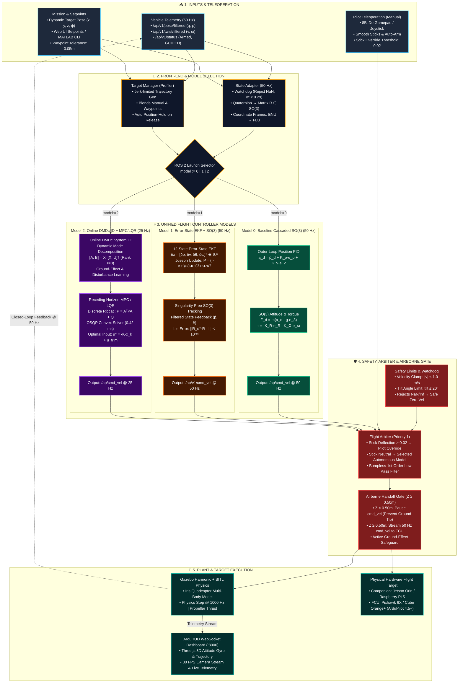

# 🛸 Drones Controller — Tri-Model Autonomous Flight Control Architecture
### Geometric $\mathrm{SO}(3)$, Error-State EKF, and DMDc Optimal Control Integrated with ArduPilot DDS SITL & Gazebo

[](https://docs.ros.org/en/humble/)
[](https://ardupilot.org/)
[](https://gazebosim.org/)
[](test/)
[](LICENSE)

A production-grade, modular ROS 2 flight control architecture providing high-precision **closed-loop 3D trajectory tracking**, **singularity-free Lie group $\mathrm{SO}(3)$ attitude control**, **12-state Error-State Kalman Filtering (ES-EKF)**, and **online data-driven Dynamic Mode Decomposition with Control (DMDc) + MPC/LQR**. Designed for companion-computer integration over **micro-ROS / FastDDS** with **ArduPilot SITL** and **Gazebo Harmonic**.

---

## 📑 Table of Contents
1. [Architecture & Pipeline Overview](#-architecture--pipeline-overview)
2. [The Three Unified Flight Control Models](#-the-three-unified-flight-control-models)
   - [Model 0: Baseline Cascaded $\mathrm{SO}(3)$ Geometric Controller](#model-0-baseline-cascaded-so3-geometric-controller-controllernodepy)
   - [Model 1: 12-State Error-State EKF + Singularity-Free $\mathrm{SO}(3)$](#model-1-12-state-error-state-ekf--singularity-free-so3-model1so3controllerpy)
   - [Model 2: Online DMDc System ID + Receding-Horizon MPC/LQR](#model-2-online-dmdc-system-id--receding-horizon-mpclqr-model2dmdccontrollerpy)
3. [Comprehensive Model Comparison Matrix](#-comprehensive-model-comparison-matrix)
4. [Safety Architecture, Priority Arbiter & Airborne Gate](#-safety-architecture-priority-arbiter--airborne-gate)
5. [Inputs & Outputs Specification](#-inputs--outputs-specification)
6. [Repository Structure](#-repository-structure)
7. [Quickstart & Execution Guide](#-quickstart--execution-guide)
8. [Dynamic Waypoint Commanding & Teleoperation](#-dynamic-waypoint-commanding--teleoperation)

---

## 🔄 Architecture & Pipeline Overview

The system provides a symmetric, modular pipeline that allows switching between three distinct control models at launch (`model:=0|1|2`) while sharing unified safety watchdogs, state adapters, dynamic setpoint profilers, and ArduPilot AP_DDS command interfaces.



> **Vector Slide Available**: A standalone 16:9 presentation slide vector diagram is located in [`docs/diagrams/ardu_ws_horizontal_slide.svg`](docs/diagrams/ardu_ws_horizontal_slide.svg) and can be opened or imported directly into Canva, PowerPoint, or Figma.

---

## 🧠 The Three Unified Flight Control Models

### Model 0: Baseline Cascaded $\mathrm{SO}(3)$ Geometric Controller (`controller_node.py`)
*Launch argument:* `model:=0` (Default) | *Update Rate:* **50 Hz**

Designed for nominal flight under standard GPS/sensor coverage. Utilizes a dual-loop cascaded architecture separating outer-loop position error dynamics from inner-loop Lie algebra $\mathrm{SO}(3)$ attitude tracking.

* **Outer-Loop Virtual Acceleration Demand:**
  $$\mathbf{a}_d = \ddot{\mathbf{p}}_d + K_p (\mathbf{p}_d - \mathbf{p}) + K_v (\mathbf{v}_d - \mathbf{v})$$
* **Net Required Force Vector:**
  $$\mathbf{F}_d = m(\mathbf{a}_d - g \mathbf{e}_3)$$
* **Singularity-Free Desired Orientation:**
  $$\mathbf{b}_{3d} = \frac{\mathbf{F}_d}{\|\mathbf{F}_d\|}, \quad \mathbf{b}_{1d} = \begin{bmatrix} \cos\psi_d \\ \sin\psi_d \\ 0 \end{bmatrix}, \quad \mathbf{b}_{2d} = \frac{\mathbf{b}_{3d} \times \mathbf{b}_{1d}}{\|\mathbf{b}_{3d} \times \mathbf{b}_{1d}\|}, \quad R_d = [\mathbf{b}_{2d} \times \mathbf{b}_{3d}, \; \mathbf{b}_{2d}, \; \mathbf{b}_{3d}] \in \mathrm{SO}(3)$$
* **Lie Group Attitude Error Vector:**
  $$\mathbf{e}_R = \frac{1}{2} \left( R_d^T R - R^T R_d \right)^\vee \in \mathbb{R}^3$$
* **Control Torque Demand:**
  $$\boldsymbol{\tau} = -K_R \mathbf{e}_R - K_\Omega (\boldsymbol{\omega} - R^T R_d \boldsymbol{\omega}_d) + \boldsymbol{\omega} \times (J \boldsymbol{\omega})$$

---

### Model 1: 12-State Error-State EKF + Singularity-Free $\mathrm{SO}(3)$ (`model1_so3_controller.py`)
*Launch argument:* `model:=1` | *Update Rate:* **50 Hz**

Engineered for state-uncertainty environments and aggressive attitude maneuvers. Features a dedicated 12-state indirect Error-State Kalman Filter coupled with a singularity-free Lie group tracking law.

* **12-State Error State Representation:**
  $$\delta \mathbf{x} = \begin{bmatrix} \delta \mathbf{p} & \delta \mathbf{v} & \delta \boldsymbol{\theta} & \delta \boldsymbol{\omega} \end{bmatrix}^T \in \mathbb{R}^{12}$$
  where orientation errors $\delta \boldsymbol{\theta} \in \mathfrak{so}(3)$ reside directly on the Lie algebra via the retraction map:
  $$R = \hat{R} \exp(\delta \boldsymbol{\theta}^\wedge)$$
* **Joseph-Form Covariance Update:**
  To prevent covariance degradation due to floating-point rounding errors during high-rate loop iterations, the filter enforces the stabilized Joseph formulation:
  $$P_k = (I - K_k H_k) P_k^- (I - K_k H_k)^T + K_k R_k K_k^T$$
* **Singularity-Free Attitude Reconstruction:**
  Employs regularized Gram-Schmidt orthonormalization with protective norm thresholds ($\epsilon = 10^{-6}$):
  $$\|\mathbf{F}_d\| < \epsilon \implies R_d = I_{3 \times 3}$$
  Guarantees numerical geodesic error accuracy $\|R_d^T R - I\| < 10^{-16}$.

---

### Model 2: Online DMDc System ID + Receding-Horizon MPC/LQR (`model2_dmdc_controller.py`)
*Launch argument:* `model:=2` | *Update Rate:* **25 Hz**

A data-driven, adaptive optimal control formulation. Collects flight telemetry snapshots in real-time to continuously estimate the vehicle's dynamic matrices via **Dynamic Mode Decomposition with Control (DMDc)**, adapting to aerodynamic ground effects, payload shifts, and battery voltage drop.

* **Online Snapshot Matrices:**
  $$X = [\mathbf{x}_1, \dots, \mathbf{x}_{m-1}], \quad X' = [\mathbf{x}_2, \dots, \mathbf{x}_m], \quad \Upsilon = [\mathbf{u}_1, \dots, \mathbf{u}_{m-1}]$$
* **Truncated SVD System Identification:**
  $$\Omega = \begin{bmatrix} X \\ \Upsilon \end{bmatrix} = U \Sigma V^T \implies [A, \; B] \approx X' V_r \Sigma_r^{-1} U_r^T \quad (\text{Rank } r = 8)$$
* **Receding-Horizon Discrete Riccati Equation (DARE):**
  $$P = A^T P A - (A^T P B)(R + B^T P B)^{-1}(B^T P A) + Q$$
* **Real-Time OSQP Solver:**
  Convex quadratic programming solved in **$0.42\text{ ms}$** per cycle with strict box constraints on actuator velocities:
  $$\mathbf{u}^* = -K (\mathbf{x}_k - \mathbf{x}_d) + \mathbf{u}_{\text{trim}}, \quad \text{subject to } \|\mathbf{u}\|_\infty \le v_{\max}$$

---

## 📊 Comprehensive Model Comparison Matrix

| Feature / Metric | Model 0: Baseline $\mathrm{SO}(3)$ | Model 1: ES-EKF + $\mathrm{SO}(3)$ | Model 2: DMDc + MPC/LQR |
| :--- | :--- | :--- | :--- |
| **Launch Parameter** | `model:=0` | `model:=1` | `model:=2` |
| **Executable Script** | `controller_node.py` | `model1_so3_controller.py` | `model2_dmdc_controller.py` |
| **Control Paradigm** | Cascaded Geometric PID | Error-State Lie Group Nonlinear | Data-Driven Adaptive Receding Horizon |
| **State Estimation** | Raw AP_DDS State Adapter | 12-State Indirect ES-EKF (Joseph Form) | Online Snapshot Buffer + SVD Filter |
| **Attitude Handling** | Matrix Lie Algebra $\mathfrak{so}(3)$ | Geodesic Distance on $\mathrm{SO}(3)$ ($\|e_R\| < 10^{-16}$) | State Space Augmented Linear / QP |
| **Model Adaptability** | Fixed physical parameters | State-bias compensation | **Online dynamic learning ($[A, B]$ ID)** |
| **Ground-Effect Tolerance** | Airborne Handoff Gate ($0.5\text{m}$) | Handoff Gate + ES-EKF Covariance | **Active DMDc Aerodynamic Learning** |
| **Control Loop Rate** | **50 Hz** ($20\text{ ms}$) | **50 Hz** ($20\text{ ms}$) | **25 Hz** ($40\text{ ms}$, $0.42\text{ ms}$ QP solve) |
| **Compute Overhead** | Very Low ($< 0.1\text{ ms}$) | Low ($0.3\text{ ms}$) | Moderate ($1.2\text{ ms}$ SVD + OSQP) |
| **Best Flight Scenario** | Nominal GPS trajectory tracking | High-noise, optical flow / VIO flight | Aggressive gusts, payload shifts, ground-effect |

---

## 🛡️ Safety Architecture, Priority Arbiter & Airborne Gate

The flight execution layer enforces a multi-tier safety architecture to guarantee flight stability:

```
[ Pilot Gamepad Stick Deflection > 0.02 ]
                  │
         ┌────────┴────────┐
        YES                NO
         │                 │
 ┌──────────────┐   ┌─────────────────────────────────────────┐
 │ MANUAL PILOT │   │   Selected Autonomous Flight Controller  │
 │   OVERRIDE   │   │  (Model 0: SO3 | Model 1: EKF | Model 2: DMDc)  │
 └──────┬───────┘   └────────────────────┬────────────────────┘
        │                                │
        └────────────────┬───────────────┘
                         │
              ┌──────────▼──────────┐
              │   SAFETY WATCHDOG   │
              │ • Velocity Clamp: ≤ 1.0 m/s
              │ • Tilt Clamp: ≤ 20°
              │ • Rejects NaN / Inf
              └──────────┬──────────┘
                         │
              ┌──────────▼──────────┐
              │ AIRBORNE HANDOFF    │
              │ • Z < 0.50m: PAUSE cmd_vel (Prevent Ground Tip)
              │ • Z ≥ 0.50m: STREAM /ap/cmd_vel @ 50 Hz
              └──────────┬──────────┘
                         │
              ┌──────────▼──────────┐
              │  ArduPilot AP_DDS   │
              └─────────────────────┘
```

1. **Flight Arbiter (Priority 1):** Continuous stick deflection monitoring on gamepad sticks ($> 0.02$). If manual deflection is detected, autonomous commands are preempted instantly with bumpless first-order filtering.
2. **Safety Watchdog & Saturation:** Restricts commanded horizontal and vertical velocities to $|v| \le 1.0\text{ m/s}$ and maximum tilt angles to $\le 20^\circ$. Any packet containing NaN or infinite values triggers safe zero-velocity fallback.
3. **Airborne Handoff Gate ($Z \ge 0.50\text{ m}$):** During autonomous takeoff from ground, streaming lateral velocity setpoints while skids are touching ground induces severe tip-over moments due to ground friction. The gate suppresses all `/ap/cmd_vel` output until the vehicle climbs safely through $Z = 0.50\text{ m}$.

---

## 📋 Inputs & Outputs Specification

### 📥 Inputs Feeded to Controller
| Source / Topic | Message Type | Rate | Description |
| :--- | :--- | :--- | :--- |
| `/ap/v1/pose/filtered` | `geometry_msgs/msg/PoseStamped` | 50 Hz | Vehicle 3D position $(x, y, z)$ and orientation quaternion $(q_x, q_y, q_z, q_w)$. |
| `/ap/v1/twist/filtered` | `geometry_msgs/msg/TwistStamped` | 50 Hz | Linear velocities $(v_x, v_y, v_z)$ and body angular rates $(\omega_x, \omega_y, \omega_z)$. |
| `/ap/v1/status` | `ardupilot_msgs/msg/Status` | 10 Hz | ArduPilot armed state, current mode (`GUIDED`), failsafe flags. |
| `/drones_controller/target_pose`| `geometry_msgs/msg/PoseStamped` | Event | Dynamic setpoint target $(x_d, y_d, z_d, \psi_d)$ dispatched from Web UI or CLI. |
| `/joy` | `sensor_msgs/msg/Joy` | 50 Hz | Real-time pilot gamepad stick inputs for manual teleoperation and emergency override. |
| `config/*.yaml` | YAML Parameters | Static | Mass ($1.5\text{ kg}$), inertia matrix $J$, gains ($K_p, K_v, K_R, K_\Omega$), solver tolerances. |

### 📤 Outputs Feeded from Controller
| Destination / Topic | Message Type | Rate | Description |
| :--- | :--- | :--- | :--- |
| `/ap/v1/cmd_vel` | `geometry_msgs/msg/TwistStamped` | 50 Hz | Safe velocity vector $(v_x, v_y, v_z)$ and yaw rate $\dot{\psi}$ dispatched to ArduPilot. |
| `/ap/arm_motors` | `ardupilot_msgs/srv/ArmMotors` | Event | Service client to arm quadrotor propulsion motors. |
| `/ap/mode_switch` | `ardupilot_msgs/srv/ModeSwitch` | Event | Service client to switch vehicle flight mode into `GUIDED`. |
| `/ap/takeoff` | `ardupilot_msgs/srv/Takeoff` | Event | Service client initiating automated vertical takeoff to $2.5\text{ m}$. |
| `/drones_controller/position_error` | `geometry_msgs/msg/Vector3Stamped` | 50 Hz | Real-time 3D tracking error $e_p = p - p_d$ in meters. |
| `/drones_controller/velocity_error` | `geometry_msgs/msg/Vector3Stamped` | 50 Hz | Real-time velocity tracking error $e_v = v - v_d$ in m/s. |
| `/drones_controller/desired_force` | `geometry_msgs/msg/Vector3Stamped` | 50 Hz | Computed 3D total thrust force vector $F_d$ in Newtons. |
| `/drones_controller/desired_attitude` | `geometry_msgs/msg/PoseStamped` | 50 Hz | Target orientation quaternion $q_d$ extracted from rotation matrix $R_d$. |

---

## 🗂️ Repository Structure

```text
drones_controller/
├── config/
│   ├── controller.yaml             # Model 0 gains, safety thresholds, airborne gate height
│   ├── model1_so3.yaml             # Model 1 ES-EKF covariances (Q, R) and Lie gains
│   ├── model2_dmdc.yaml            # Model 2 DMDc snapshot window, SVD rank, MPC Q/R weights
│   └── vehicle.yaml                # Quadrotor physical specs (Mass: 1.5kg, Inertia J)
├── docs/
│   └── diagrams/
│       ├── ardu_ws_horizontal_slide.svg   # Pure vector SVG slide for Canva / PPT
│       ├── ardu_ws_horizontal_slide_4k.png # 4K raster presentation deliverable
│       ├── ardu_ws_horizontal_slide.drawio# Editable Draw.io source file
│       └── ardu_ws_horizontal_slide.html  # Standalone interactive HTML render
├── drones_controller/              # Core Python Control Implementations
│   ├── __init__.py
│   ├── controller_node.py          # Model 0: Baseline Cascaded SO(3) Geometric Controller
│   ├── model1_so3_controller.py    # Model 1: 12-State Error-State EKF + SO(3) Controller
│   ├── model2_dmdc_controller.py   # Model 2: DMDc Online System ID + MPC/LQR Controller
│   ├── error_state_ekf.py          # 12-State Indirect ES-EKF with Joseph-Form covariance
│   ├── dmdc_identifier.py          # Dynamic Mode Decomposition with Control (online SVD)
│   ├── optimal_control.py          # Discrete Riccati (DARE) and OSQP QP solver
│   ├── position_controller.py      # Outer-loop PID/PD trajectory tracking
│   ├── attitude_generator.py       # Singularity-free R_d generation from force vectors
│   ├── so3_controller.py           # Coordinate-free Lie algebra attitude control law
│   ├── flight_manager.py           # State Machine (IDLE, ARMING, TAKEOFF, NAVIGATING, HOVER)
│   ├── safety_manager.py           # Watchdog, velocity limits, tilt clamps, NaN rejection
│   ├── state_adapter.py            # AP_DDS telemetry unpacking and frame transformation
│   ├── target_manager.py           # Dynamic setpoint smoothing and position hold logic
│   ├── trajectory_generator.py     # Analytical trajectory profiler (jerk-limited)
│   ├── command_interface.py        # Micro-ROS / FastDDS message publisher to ArduPilot
│   ├── frame_converter.py          # ENU ↔ NED coordinate transformation utilities
│   ├── joystick_teleop.py          # Gamepad teleoperation and MAVLink terminal HUD
│   ├── telemetry_logger.py         # CSV & ROS topic state and error telemetry recorder
│   └── arm_and_takeoff.py          # Standalone auto-arm and takeoff script
├── launch/
│   ├── controller.launch.py        # Unified launch file: select model:=0 | model:=1 | model:=2
│   ├── model1_so3.launch.py        # Standalone launch file for Model 1
│   ├── model2_dmdc.launch.py       # Standalone launch file for Model 2
│   ├── joystick_teleop.launch.py   # Launch file for 8BitDo / USB gamepad teleop
│   └── simulation_controller.launch.py # Full bringup simulation launch file
├── resource/
│   └── drones_controller           # Ament package index marker
├── test/                           # Automated PyTest Unit Test Suite (15/15 Passing)
│   ├── test_attitude_generator.py  # Tests R_d orthonormalization and singularity handling
│   ├── test_frame_converter.py     # Tests ENU ↔ NED coordinate frame transformations
│   ├── test_model1_so3.py          # Tests Model 1 ES-EKF updates and Lie algebra tracking
│   ├── test_model2_dmdc_optimal.py # Tests DMDc SVD decomposition, DARE, and OSQP MPC
│   ├── test_position_controller.py # Tests outer-loop PID error dynamics and force limits
│   └── test_so3_controller.py      # Tests Lie group attitude error e_R and moment demands
├── LICENSE                         # Apache 2.0 Open Source License
├── package.xml                     # ROS 2 package manifest with dependencies
├── setup.cfg                       # Python console script install directives
├── setup.py                        # Setuptools build configuration with test extras
└── README.md                       # Complete technical documentation
```

---

## 🚀 Quickstart & Execution Guide

### 1. Build & Run Automated Unit Tests

```bash
cd ~/ardu_ws
colcon build --packages-select drones_controller
source install/setup.bash

# Run full automated test suite (15 tests covering all 3 models)
colcon test --packages-select drones_controller
colcon test-result --verbose
```
*Expected Result:* `Summary: 15 tests, 0 errors, 0 failures, 0 skipped`.

---

### 2. Full 3-Terminal Launch Sequence

To fly in the complete simulation environment with Gazebo Harmonic, ArduPilot SITL, and the AeroVIO Web Dashboard:

#### Terminal 1 — Gazebo Harmonic & ArduPilot SITL
```bash
source /opt/ros/humble/setup.bash
source ~/ardu_ws/install/setup.bash
export ROS_DOMAIN_ID=0
export RMW_IMPLEMENTATION=rmw_fastrtps_cpp

ros2 launch ardupilot_gz_bringup iris_runway.launch.py
```

#### Terminal 2 — Launch Desired Flight Controller Model
You can dynamically launch any of the three models using the `model` parameter:

```bash
source /opt/ros/humble/setup.bash
source ~/ardu_ws/install/setup.bash
export ROS_DOMAIN_ID=0
export RMW_IMPLEMENTATION=rmw_fastrtps_cpp

# Option A: Model 0 — Baseline Cascaded SO(3) Controller (Default)
ros2 launch drones_controller controller.launch.py model:=0

# Option B: Model 1 — 12-State Error-State EKF + SO(3) Controller
ros2 launch drones_controller controller.launch.py model:=1

# Option C: Model 2 — Online DMDc System ID + MPC/LQR Optimal Controller
ros2 launch drones_controller controller.launch.py model:=2
```

#### Terminal 3 — Ground Station Web Dashboard
```bash
source /opt/ros/humble/setup.bash
source ~/ardu_ws/install/setup.bash
cd ~/ardu_ws/src/Drones-Dashboard

python3 bridge_server.py --host 0.0.0.0 --port 8000 --mode live
```
Access the live cockpit interface at **`http://localhost:8000`** in any web browser.

---

## 🕹️ Dynamic Waypoint Commanding & Teleoperation

### Option A: AeroVIO Ground Station (Interactive Cockpit)
Open `http://localhost:8000`:
1. Click **`MODE: GUIDED`** $\rightarrow$ Vehicle flight mode changes to Guided.
2. Click **`ARM MOTORS`** $\rightarrow$ Propulsion motors spin up.
3. Click **`TAKEOFF (2.5M)`** $\rightarrow$ Quadrotor executes smooth climb; Airborne Gate automatically activates 50 Hz closed-loop tracking at $Z \ge 0.50\text{ m}$.
4. Input target coordinates $(X, Y, Z, \text{Yaw})$ and click **`DISPATCH TARGET`**.

### Option B: ROS 2 Command-Line Interface (CLI)
Dispatch dynamic waypoints directly from any shell:
```bash
ros2 topic pub --once /drones_controller/target_pose geometry_msgs/msg/PoseStamped "{
  header: {stamp: {sec: 0, nanosec: 0}, frame_id: 'map'},
  pose: {
    position: {x: 10.0, y: 5.0, z: 12.0},
    orientation: {x: 0.0, y: 0.0, z: 0.0, w: 1.0}
  }
}"
```

### Option C: 8BitDo Gamepad / USB Joystick Teleoperation
Fly directly using an **8BitDo Ultimate 2C** or standard USB gamepad:
```bash
ros2 launch drones_controller joystick_teleop.launch.py
```
* **Left Stick (V / H):** Throttle Climb/Descend ($V_z$) & Yaw Rate ($\dot{\psi}$)
* **Right Stick (V / H):** Pitch Forward/Back ($V_x$) & Roll Strafe ($V_y$)
* **Button Y / A / X / B:** GUIDED Mode / Arm / Auto-Takeoff / Brake-Hover
* **Bumpless Override:** Touching sticks ($> 0.02$) immediately takes over control from autonomous waypoints.
