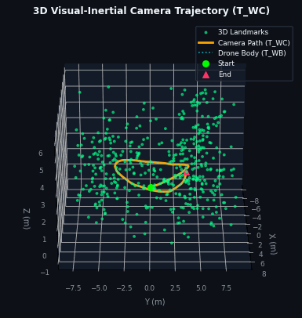
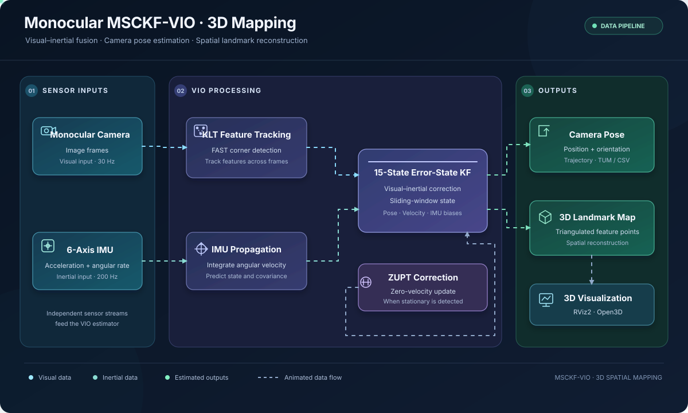
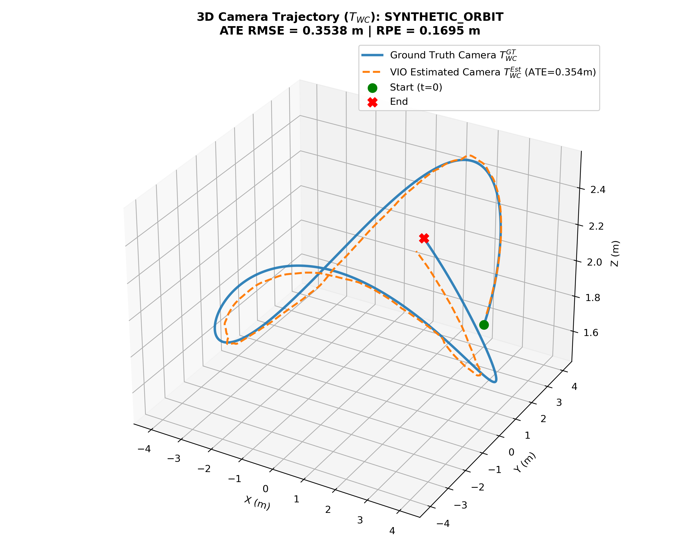
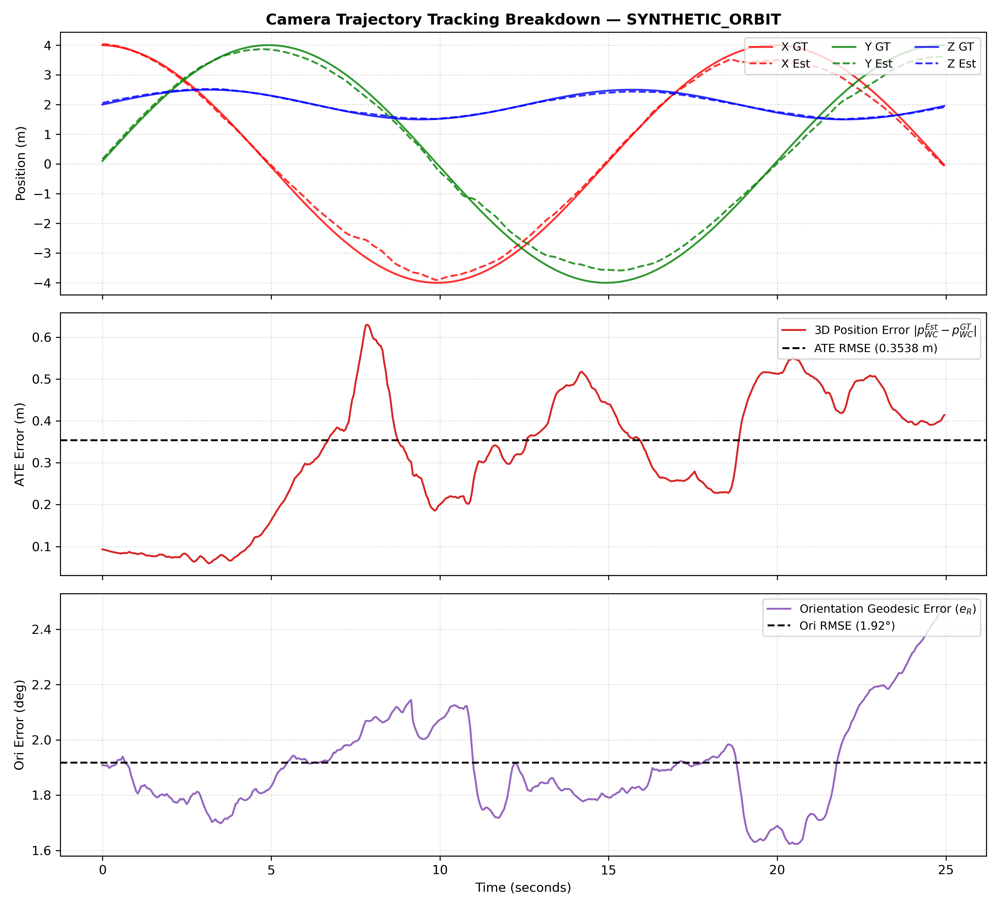

# 🚁 Monocular Visual-Inertial Odometry & 3D Mapping

<div align="center">

### MSCKF-VIO · Camera Pose Estimation · Dense 3D Reconstruction

[](https://docs.ros.org/en/humble/)
[](https://www.python.org/)
[](https://opencv.org/)
[](https://www.open3d.org/)
[](https://plotly.com/)
[](LICENSE)

**Visual navigation and 3D spatial reconstruction using a monocular camera and an IMU.**

A modular Visual-Inertial Odometry (VIO) pipeline designed to estimate camera motion, track spatial landmarks, evaluate trajectory accuracy, and reconstruct 3D environments without relying on GPS.

</div>

---

## 📸 Project Showcase

<div align="center">

### 3D Camera Trajectory & Spatial Landmarks



*An example circular-orbit sequence showing the estimated camera and body trajectories alongside triangulated 3D landmarks.*

</div>

### Coordinate-Frame Visualization

- 🟠 **Amber:** Camera optical-center trajectory, $T_{WC}$
- 🔵 **Cyan:** Drone body trajectory, $T_{WB}$
- 🟢 **Green:** Triangulated 3D landmarks

[**View the Interactive 3D Trajectory →**](results/plots/interactive_3d_trajectory.html)

The interactive visualization supports rotation, panning, zooming, and coordinate inspection in a web browser.

---

## 🌐 Overview

GPS-denied environments such as indoor spaces, warehouses, and underground facilities create significant challenges for autonomous navigation.

This project explores a camera-and-IMU-based approach to estimating motion and reconstructing surrounding geometry.

### Core Idea

| Sensor | Role | Nominal Rate |
|---|---|---:|
| 👁️ Monocular camera | Tracks visual features across consecutive frames | 30 Hz |
| 🧭 6-axis IMU | Measures angular velocity and linear acceleration | 200 Hz |

The system combines visual observations with inertial measurements through a **Multi-State Constraint Kalman Filter (MSCKF)** to estimate motion and maintain a map of 3D landmarks.

The implementation also includes trajectory export, quantitative evaluation, visualization tools, and a modular dense-reconstruction pipeline.



---

## ✨ Key Features

<details open>
<summary><strong>State Estimation & Visual Tracking</strong></summary>

- Lucas–Kanade (KLT) optical-flow feature tracking.
- FAST corner detection.
- IMU-driven state propagation and covariance estimation.
- Error-State Kalman Filter (ESKF) with MSCKF landmark updates.
- Sliding-window camera-state clones.
- Zero-Velocity Updates (ZUPT), where applicable.
- Multi-view triangulation of 3D landmarks.

</details>

<details>
<summary><strong>Camera Geometry & Trajectory Export</strong></summary>

- Explicit camera and body coordinate frames.
- Rigid transformations using $SE(3)$.
- TUM-format trajectory export.
- CSV trajectory export.
- Estimated-versus-ground-truth trajectory comparison.

The camera pose is derived from the body pose and the calibrated body-to-camera extrinsic transform:

$$
T_{WC} = T_{WB} T_{BC}
$$

where:

- $T_{WB}$: World-to-body pose.
- $T_{BC}$: Body-to-camera extrinsic transform.
- $T_{WC}$: World-to-camera pose.

The equation assumes the project's transform convention, with $T_{AB}$ mapping coordinates from frame $B$ into frame $A$.

</details>

<details>
<summary><strong>3D Reconstruction & Visualization</strong></summary>

- Motion-based keyframe selection.
- Plane-sweep and epipolar multi-view stereo depth estimation.
- Back-projection and depth fusion.
- Truncated Signed Distance Function (TSDF) volumetric fusion.
- Poisson surface reconstruction.
- Point-cloud filtering and 3D mesh generation.
- Interactive Open3D and Plotly visualizations.

</details>

<details>
<summary><strong>Evaluation & Diagnostics</strong></summary>

- Absolute Trajectory Error (ATE).
- Relative Pose Error (RPE).
- Umeyama alignment.
- Orientation-error analysis.
- Synthetic flight profiles and stress testing.
- Automated benchmark and test scripts.

</details>

---

## 🧮 Mathematical Foundations

### 1. Visual-Inertial State Estimation

The IMU provides high-frequency inertial measurements, while the camera provides visual constraints. Combining these measurements enables the estimator to track motion using complementary sensor information.

A simplified inertial propagation model is:

$$
\dot{\mathbf{p}} = \mathbf{v}
$$

$$
\dot{\mathbf{v}} =
R_{WB}(\mathbf{a}_m - \mathbf{b}_a) + \mathbf{g}
$$

$$
\dot{R}_{WB} =
R_{WB}[\boldsymbol{\omega}_m - \mathbf{b}_g]_\times
$$

where:

- $\mathbf{p}$ and $\mathbf{v}$: Position and velocity.
- $R_{WB}$: Body orientation in the world frame.
- $\mathbf{a}_m$ and $\boldsymbol{\omega}_m$: Measured acceleration and angular velocity.
- $\mathbf{b}_a$ and $\mathbf{b}_g$: Accelerometer and gyroscope biases.
- $\mathbf{g}$: Gravity vector.
- $[\cdot]_\times$: Skew-symmetric matrix associated with a 3D vector.

These equations illustrate the underlying inertial model. The estimator's precise state definition and coordinate-frame conventions are determined by the implementation and configuration.

### 2. Multi-View Landmark Triangulation

Tracked image observations from multiple camera poses provide geometric constraints for estimating 3D landmark positions.

For a landmark $\mathbf{P}$, its image observation can be expressed using the camera projection model:

$$
\mathbf{u} \sim K [R_{CW} \mid \mathbf{t}_{CW}] \mathbf{P}
$$

where:

- $K$: Camera intrinsic matrix.
- $R_{CW}$: World-to-camera rotation matrix.
- $\mathbf{t}_{CW}$: World-to-camera translation vector.
- $\mathbf{P}$: 3D landmark position in the world frame.
- $\mathbf{u}$: Image observation in homogeneous coordinates.

### 3. Trajectory Evaluation

Trajectory estimates are aligned with ground truth using Umeyama alignment before calculating the reported trajectory metrics.

- **Absolute Trajectory Error (ATE):** Measures global positional disagreement after alignment.
- **Relative Pose Error (RPE):** Measures relative-motion error over a specified interval.

**Note:** Metrics depend on the input sequences, coordinate conventions, alignment settings, and evaluation procedure. The benchmark results below are the values recorded in this repository; they are not universal performance guarantees.

---

## 🗂️ Project Documentation

The project is organized into focused modules, each with its own implementation and supporting documentation.

| Module | Responsibilities | Documentation |
|---|---|---|
| **Core Estimator** | Feature tracking, IMU propagation, MSCKF updates, ZUPT | [`core/README.md`](core/README.md) |
| **Trajectory** | Camera extrinsics, pose conversion, trajectory export | [`trajectory/README.md`](trajectory/README.md) |
| **Reconstruction** | Keyframes, MVS depth, dense fusion, surface meshing | [`reconstruction/README.md`](reconstruction/README.md) |
| **Evaluation** | Synthetic presets, alignment, ATE/RPE benchmarks | [`evaluation/README.md`](evaluation/README.md) |
| **Results** | Plots, exported trajectories, reconstruction artifacts | [`results/README.md`](results/README.md) |

---

## 📊 Evaluation & Results

The repository includes benchmark runs across five synthetic flight profiles. The table below preserves the recorded benchmark values.

### Benchmark Summary

| Flight Profile | Scenario | Camera ATE (RMSE) | RPE Drift | Geodesic Orientation Error |
|---|---|---:|---:|---:|
| 🔄 **Orbit** | 360° circular inspection | **0.3538 m** | **0.1695 m/s** | **1.92°** |
| 🔀 **Multi-Axis** | Coupled 6-DoF motion | **0.3834 m** | **0.1954 m/s** | **4.41°** |
| 🛸 **Hover** | Stationary hovering | **0.1341 m** | **0.0186 m/s** | 160.60° |
| ⚡ **Straight** | Forward acceleration | 2.7091 m | 0.8255 m/s | 46.78° |
| ⚠️ **Stress** | 50% feature loss and noise spikes | 52.1553 m | 13.1805 m/s | 160.89° |

**Interpretation:** The orbit and multi-axis sequences have relatively low reported orientation error. The straight and stress scenarios exhibit substantially larger reported positional errors, indicating cases where further estimator tuning and robustness improvements may be useful.

The hover sequence has a low positional error but a high orientation error, illustrating why translation and orientation metrics should be considered separately.

### Trajectory & Error Visualizations

<div align="center">

| 3D Trajectory Comparison | Error Dashboard |
|:---:|:---:|
|  |  |
| *Ground truth (blue) vs. VIO estimate (orange)* | *Translation errors and angular drift over time* |

</div>

### Benchmark Data

<details>
<summary><strong>📄 View CSV Summary and TUM Trajectory Sample</strong></summary>

#### Master Benchmark Summary

Source: [`results/summary.csv`](results/summary.csv)

```csv
Sequence,Camera ATE (m),RPE (m),Orientation (deg),Velocity (m/s)
Hover,0.1341,0.0186,160.60,0.0185
Straight,2.7091,0.8255,46.78,0.8659
Orbit,0.3538,0.0186,1.92,0.2423
Multi_axis,0.3834,0.1954,4.41,0.2365
Stress,52.1553,13.1805,160.89,15.1754
```

#### TUM Camera Trajectory

Source: [`results/trajectories/synthetic_orbit_camera_trajectory.tum`](results/trajectories/synthetic_orbit_camera_trajectory.tum)

The standard TUM trajectory format stores a timestamp, position, and quaternion:

```text
# timestamp tx ty tz qx qy qz qw
0.000000 4.099955 0.000000 2.500000 0.500000 0.500000 -0.500000 0.500000
0.050000 4.098739 0.051242 2.500000 0.499922 0.500078 -0.500078 0.499922
0.100000 4.095092 0.102464 2.500000 0.499688 0.500312 -0.500312 0.499688
0.150000 4.089017 0.153645 2.500000 0.499297 0.500702 -0.500702 0.499297
```

These trajectory exports can be inspected using compatible trajectory-analysis and 3D visualization tools.

</details>

---

## 🏗️ Project Architecture

The following table links directly to the main implementation files.

| Component | File | Purpose |
|---|---|---|
| 🖥️ Interactive viewer | [`3d_view.py`](3d_view.py) | Open3D visualization of trajectories, camera frustums, and 3D maps |
| 🏗️ Reconstruction runner | [`scripts/run_reconstruction.py`](scripts/run_reconstruction.py) | Coordinates keyframe selection, MVS, dense fusion, and mesh generation |
| 🌐 Web visualization | [`scripts/generate_interactive_3d.py`](scripts/generate_interactive_3d.py) | Generates a standalone interactive Plotly HTML graph |
| 🎞️ Trajectory animation | [`scripts/generate_3d_gif.py`](scripts/generate_3d_gif.py) | Produces rotating 3D trajectory GIFs |
| 🤖 ROS 2 node | [`ros2_nodes/vio_node.py`](ros2_nodes/vio_node.py) | Publishes and subscribes to ROS 2 data and supports auto-saving |
| 🧠 MSCKF estimator | [`core/msckf_estimator.py`](core/msckf_estimator.py) | State estimation, sliding-window clones, and filter updates |
| 👁️ Feature tracker | [`core/feature_tracker.py`](core/feature_tracker.py) | KLT optical flow and FAST corner detection |
| ⏱️ IMU propagator | [`core/imu_propagator.py`](core/imu_propagator.py) | Inertial integration and covariance propagation |
| 📐 Landmark triangulation | [`core/triangulation.py`](core/triangulation.py) | Multi-view landmark triangulation using linear DLT |
| 🛰️ Camera pose | [`trajectory/camera_pose.py`](trajectory/camera_pose.py) | Body-to-camera pose transformation |
| 💾 Trajectory exporter | [`trajectory/trajectory_exporter.py`](trajectory/trajectory_exporter.py) | TUM and CSV trajectory formatting |
| 📏 Trajectory metrics | [`trajectory/trajectory_metrics.py`](trajectory/trajectory_metrics.py) | Umeyama alignment, ATE/RPE calculation, and plotting |
| 🎯 Keyframe selector | [`reconstruction/keyframe_selector.py`](reconstruction/keyframe_selector.py) | Selects keyframes based on motion and overlap criteria |
| 🔍 MVS depth estimator | [`reconstruction/mvs_depth_estimator.py`](reconstruction/mvs_depth_estimator.py) | Multi-view stereo depth estimation |
| ☁️ Depth fusion | [`reconstruction/depth_fusion.py`](reconstruction/depth_fusion.py) | Back-projection, TSDF fusion, and point-cloud filtering |
| 🧩 Surface mesher | [`reconstruction/surface_mesher.py`](reconstruction/surface_mesher.py) | Surface reconstruction and mesh generation |
| 🧪 Benchmark runner | [`evaluation/synthetic/evaluate_synthetic.py`](evaluation/synthetic/evaluate_synthetic.py) | Runs all five synthetic flight presets |
| ⚙️ Project configuration | [`config/project_vio.yaml`](config/project_vio.yaml) | Camera parameters and sensor-noise configuration |
| 🖥️ RViz configuration | [`config/vio_rviz.rviz`](config/vio_rviz.rviz) | Visualization layout for trajectories and landmarks |

---

## 🚀 Quickstart

### Prerequisites

The existing workspace instructions target **ROS 2 Humble**, Python 3.10+, and the project's configured computer-vision and 3D-visualization dependencies.

Before running the commands below, ensure that the repository's dependencies and ROS 2 package are installed and that the expected workspace layout exists.

### 1. Build the ROS 2 Workspace

```bash
cd ~/ros2_vio_ws
source /opt/ros/humble/setup.bash

colcon build --symlink-install --packages-select vio_estimator
source install/setup.bash
```

### 2. Launch VIO and RViz2

```bash
ros2 launch vio_estimator vio_launch.py
```

The configured visualization distinguishes the main elements:

- **Amber line:** Estimated camera trajectory, $T_{WC}$.
- **Cyan line:** Estimated body trajectory, $T_{WB}$.
- **3D markers:** Triangulated landmark point cloud.

### 3. Inspect the 3D Trajectory

Open the generated interactive trajectory in a browser:

```bash
xdg-open results/plots/interactive_3d_trajectory.html
```

Alternatively, launch the Open3D desktop viewer:

```bash
python3 3d_view.py
```

The viewer and HTML file expect the relevant result artifacts to have been generated and to be available at the specified paths.

### 4. Run the Benchmark Suite

Run every synthetic flight preset:

```bash
python3 evaluation/synthetic/evaluate_synthetic.py --preset all
```

Run the test suite:

```bash
python3 -m pytest tests/
```

---

## 📂 Important Directories

```text
.
├── core/                 # MSCKF, feature tracking, IMU propagation
├── trajectory/           # Camera poses, exporters, and metrics
├── reconstruction/       # Keyframes, MVS, depth fusion, meshes
├── evaluation/           # Synthetic benchmarks and evaluation
├── ros2_nodes/           # ROS 2 integration
├── config/               # System and RViz configuration
├── scripts/              # Visualization and reconstruction utilities
├── results/
│   ├── plots/            # Trajectory plots and interactive viewer
│   └── trajectories/     # Exported trajectory data
├── docs/                 # Pipeline documentation and diagrams
└── tests/                # Automated tests
```

*This is a high-level directory guide; consult the repository for the complete file tree.*

---

## 📄 License

This project is distributed under the [MIT License](LICENSE).
