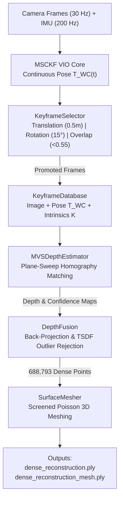

# 🏗️ Reconstruction Module — VIO-Guided Dense 3D Reconstruction

[]()
[]()
[]()

The `reconstruction/` package transforms the output of the MSCKF VIO fast loop (camera trajectory $T_{WC}$) into dense metric depth maps, high-density 3D spatial point clouds, and watertight surface meshes.

---

## 🏛️ Architecture & Component Breakdown



---

## 📋 Module Index

| Component | Responsibility | Key Formats / Methods |
| :--- | :--- | :--- |
| [`keyframe_bundle.py`](keyframe_bundle.py) | Keyframe data contract & disk serialization | `Keyframe`, `CameraIntrinsics`, NeRF/TUM bundle export |
| [`keyframe_selector.py`](keyframe_selector.py) | Dynamic view filtering for MVS baselines | Geometric translation, geodesic rotation, and feature overlap checks |
| [`mvs_depth_estimator.py`](mvs_depth_estimator.py) | Multi-view stereo depth inference | Plane-Sweep Homography Warping, Epipolar SGBM matching |
| [`depth_fusion.py`](depth_fusion.py) | Point cloud backprojection & outlier filtering | Metric back-projection, TSDF voxel integration, normal estimation |
| [`surface_mesher.py`](surface_mesher.py) | Solid surface 3D mesh generation | Screened Poisson Reconstruction, Ball-Pivoting, Voxel Grids |
| [`reconstruction_worker.py`](reconstruction_worker.py) | Asynchronous decoupled execution | Background queue worker bridging VIO with dense MVS |
| [`visualization_utils.py`](visualization_utils.py) | 3D wireframe camera frustums & object frames | Open3D frustum pyramids and object centroid bounding boxes |

---

## 🚀 How to Run Phase 3 Reconstruction

To run the complete end-to-end pipeline (VIO $\to$ Keyframing $\to$ MVS $\to$ Dense Mesh):
```bash
python3 scripts/run_reconstruction.py --preset orbit
```

To view the reconstructed dense point cloud, surface mesh, camera frustums, and object frame in the interactive 3D visualizer:
```bash
python3 3d_view.py
```
